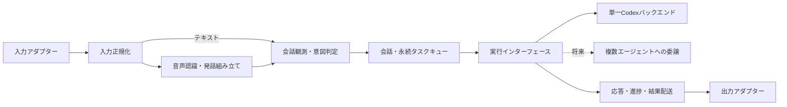

# 会話パイプラインと実行レイヤー

`src` は以下の責務に分かれています。traQ、Thunderbird、Discord Bot MCP、Discord RPCは独立した連携機能として既存のエントリーポイントを維持します。

| レイヤー                            | 責務                                                                            |
| ----------------------------------- | ------------------------------------------------------------------------------- |
| `engine/input`                      | 音声・テキスト入力の正規化、PCM/WAV、分割発話の組み立て                         |
| `engine/observation`                | 観測結果の解釈、意図判定、発言根拠と認可の照合                                  |
| `engine` のセッション・タスクキュー | 会話の進行、永続的な受付、追加指示・停止・復旧、並行実行制御                    |
| `engine/output`                     | プレーン表示、音声配送、結果配送の永続的なステップ管理                          |
| `adapters/discord`                  | 音声受信・PCM変換・再生、Markdown・文字数制限、コマンド、投稿・スレッド・ボタン |
| `execution/port.mjs`                | データだけの実行依頼と、バックエンドからの状態更新の接続                        |
| `execution/codex`                   | Codex SDK、認証隔離、スレッド、実行環境、worktree・差分反映                     |
| `providers` / `storage`             | OpenAI音声・短い回答のAPI実装、会議状態・認識テキストの保存                     |
| `runtime`                           | 設定と各実装の組み立て、外部接続・切断・終了処理                                |

依存はruntimeから各レイヤーへ向かいます。engineは自身のモジュールとNode標準機能のみをimportします。入出力アダプターからCodex実装への依存も禁止し、テストで間接importを含めて確認します。処理は直列だけではなく、即時停止、並行STT、バックグラウンドタスク、直列の読み上げを従来どおり扱います。

## 入力と出力の差し替え

`createConversationEngine({ config, audio, execution, output, store, initialState, transcriptArchive, logger, dependencies })` は `{ session, taskQueue, input }` を返します。呼び出し側は、実行バックエンドの準備、保存先の取得・解放、通信の開始・終了を担当します。`dependencies` のタイマー注入は従来のモック用です。

- `input.accept({ type: "text", text, id?, sessionId?, actor?: { id, name }, metadata? })` はSTTを経由せずセッションへ入力します。
- `input.accept({ type: "audio", audio, ... })` はsigned 16-bit PCM WAVのBufferを受け取ります。デバイス固有の音声形式はアダプターで変換します。
- `metadata` は発言者、開始時刻、`taskEligible`、`requestReply`、対象`taskId`、`requestKey`などの文脈を保持します。これらは信頼したアダプターが設定し、認識テキストに設定させません。`sessionId`が現在の会議と違う入力は拒否します。
- 分割音声は`beginUtterance` / `enqueue` / `finishUtterance`を使用します。不完全な発話や実行不可の入力からタスクの権限を作りません。
- `output.postText(text, { signal?, idempotencyKey? })` は必須です。送信失敗はrejectしてください。再送では同じキーを使います。
- `output.capabilities` の`audio`、`transcript`、`minutes`、`tasks`は既定でfalseです。有効にした機能の`playAudio`、`upsertLiveTranscript`、`upsertMinutes`、`createTaskThread`が必須です。`audio: false`ならTTSも再生も呼びません。
- 表示更新機能がない場合はライブ表示・議事録表示を省略します。内部の会議状態とアーカイブの保存は独立して継続します。
- タスク専用表示を持たない出力は、タスクIDを送信先識別子にして通常の`postText`で結果を返します。専用表示がある場合は`createTaskThread(task)`と`restoreTaskSurface(task)`で`{ threadId, starterId?, post, update, postArtifacts? }`を返します。識別子は不透明な文字列であり、engineへSDKのチャンネルオブジェクトを渡しません。
- `output.presentation`を省略するとプレーン表示です。Discordは独自のMarkdown、参照表記、分割ルールを注入します。新しいアダプターは必要な機能だけを定義します。

出力と入力は独立して交換できます。例えばデバイスの音声を`input.accept`へ渡し、出力にはテキスト表示だけを設定できます。新しいデバイスのためにセッション処理を複製しません。

## 実行バックエンドの差し替え

runtimeは`bindExecution(backend)`の戻り値をengineへ渡します。単一Codex実装は`createCodexBackend(config)`です。従来の`dependencies.codexRunner`注入も互換アダプターを通して利用でき、`dependencies.executionBackend`が指定されるとそちらを使います。

バックエンドは以下を実装します。

| メソッド                                               | 契約                                                                     |
| ------------------------------------------------------ | ------------------------------------------------------------------------ |
| `prepare()` / `resetMeeting()`                         | 必要に応じた準備・会議観測のリセット。省略可能                           |
| `run(text, options)`                                   | 直接応答。文字列を返す。`options`にsignalと入力metadata・requestIdを渡す |
| `observeMeeting(observation, { signal })`              | 現行の観測JSON形式を返す。会議ID、発言、作業・結果文脈を保持             |
| `runTask(request, { signal, onProgress, checkpoint })` | `{ text, state }`を返す。進捗は`onProgress(text)`へ返す                  |
| `applyTask(request)`                                   | `{ value, state }`を返す。既存の明示的な差分反映操作からのみ呼ぶ         |

`request`はタスクID、会議ID、requestKey、依頼・文脈、作業種別、追加指示と直前の保存状態を含むデータです。SDKオブジェクト、認証情報、Discordオブジェクト、タスクキューの内部オブジェクトは含めません。

`checkpoint(state)`は再開に必要な状態をタスク保存へ反映します。実行先・実行ハンドルはJSON化可能な`state.execution`へ保存し、進捗・結果・失敗・停止を同じタスクへ対応付けます。共通の状態フィールドは`runRevision`、`evidence`、`artifacts`、`profile`と既存のworktree・差分反映情報です。許可したフィールド以外はキューへ反映しません。`codexThreadId`は旧保存形式の互換フィールドとしてのみ保持します。

追加指示は同じタスクと保存済み`execution`を使う次の`runTask`で受け取ります。実行中の停止はその呼び出しのAbortSignalに通知します。バックエンドは終了までPromiseをsettleさせず、キューは終了を待ってから同じタスクの再開を許可します。中断でも実行ハンドルをcheckpointし、不明な外部操作を自動的に繰り返さないでください。

複数エージェントへの委譲実装は、選択したエージェントとハンドルを`execution`へ保存し、追加指示・停止・復旧でもその対応を守ります。エンジンと入出力は変更しません。本変更の委譲実装は契約テスト内のモックのみです。実際の登録・割当・協調はIssue #2、分散通信・認証はIssue #4で扱います。

## 互換性と検証

既存のCLI、環境変数、ルートの`discord-voice-*` importは互換エントリーポイントとして維持します。新しいコードは各責務のモジュールを直接importします。会議状態のversion 1、scope、DiscordのthreadId/starterId、配送ステップ番号、冪等キーを維持し、既存状態の削除や移行コマンドは不要です。出力アダプター変更時の保存先・配送先の移行は自動化しません。未配送の結果がある状態で分割・配送ルールを変更しないでください。

- `npm run verify`: 再帰的な構文確認、lint、format、全テスト・coverage、依存監査。
- `npm run smoke:discord:voice:mock`: Discord・Codex・音声APIを模擬した既存E2E。
- `test/engine-ports.test.mjs`: 入出力の交換、TTS省略、単一実行と模擬委譲、追加指示・中断・失敗・復旧・重複受付。
- `test/architecture-boundaries.test.mjs`: 禁止するレイヤー依存。

実接続のAlexa・Even G2・VRChat、分散通信、プラグイン自動探索は追加していません。
