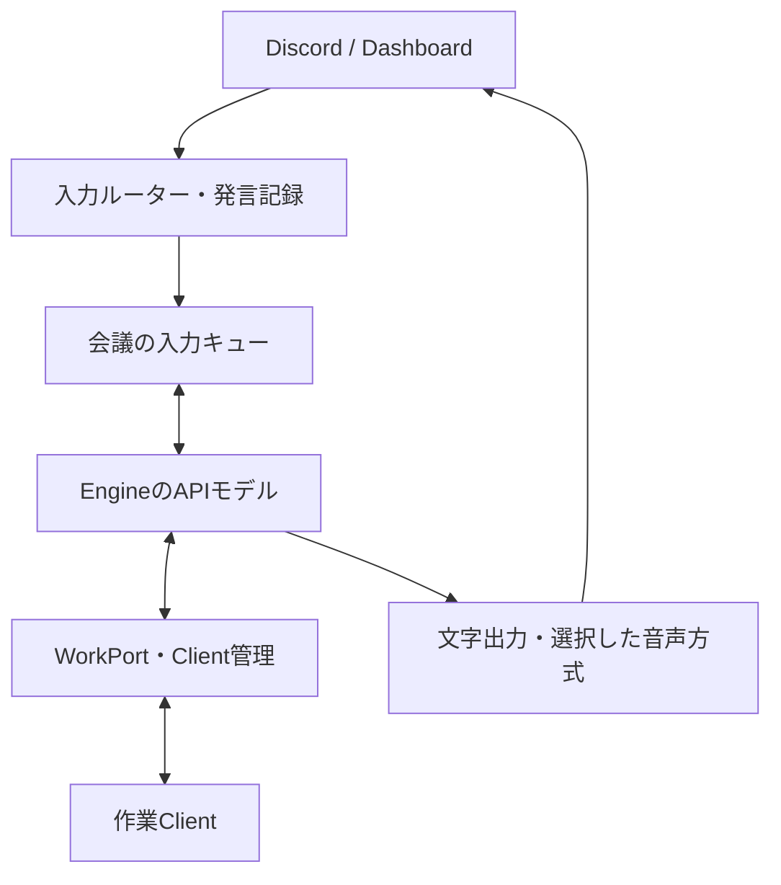
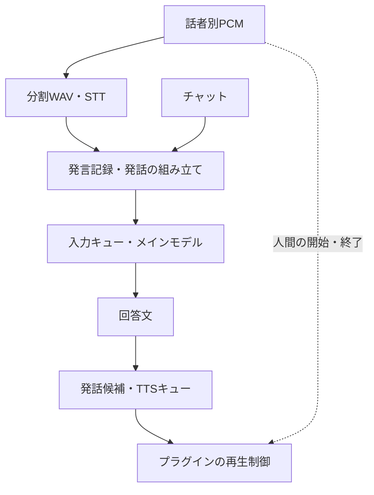
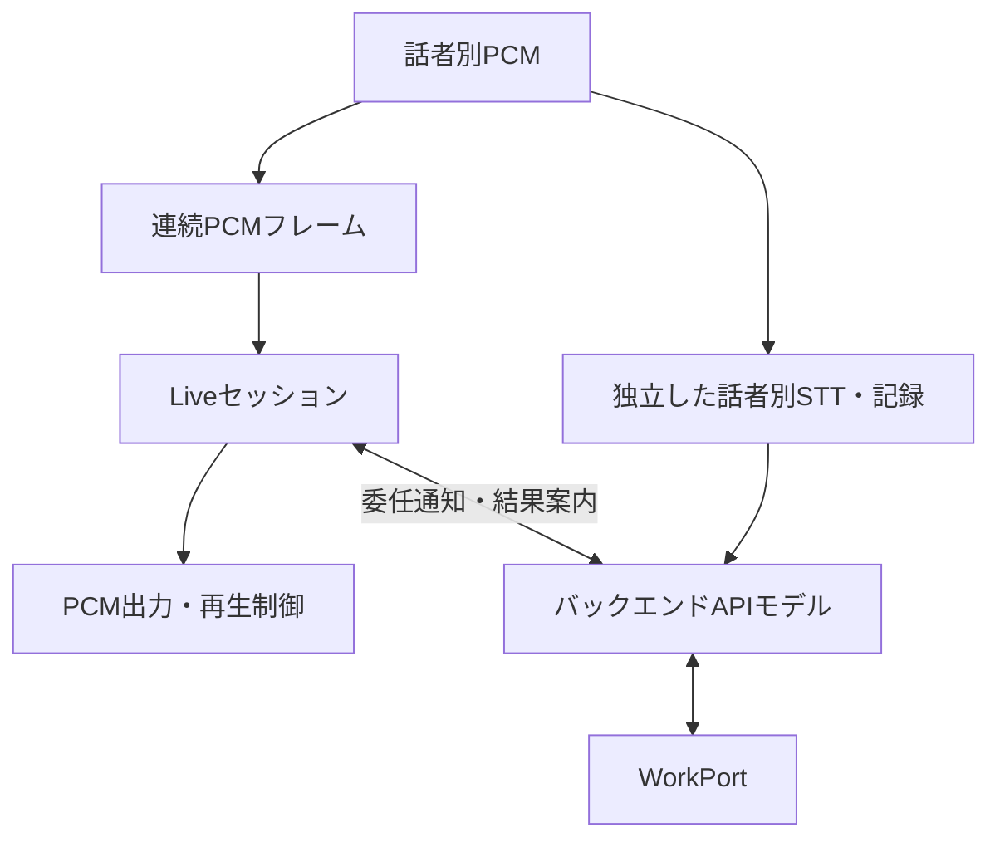
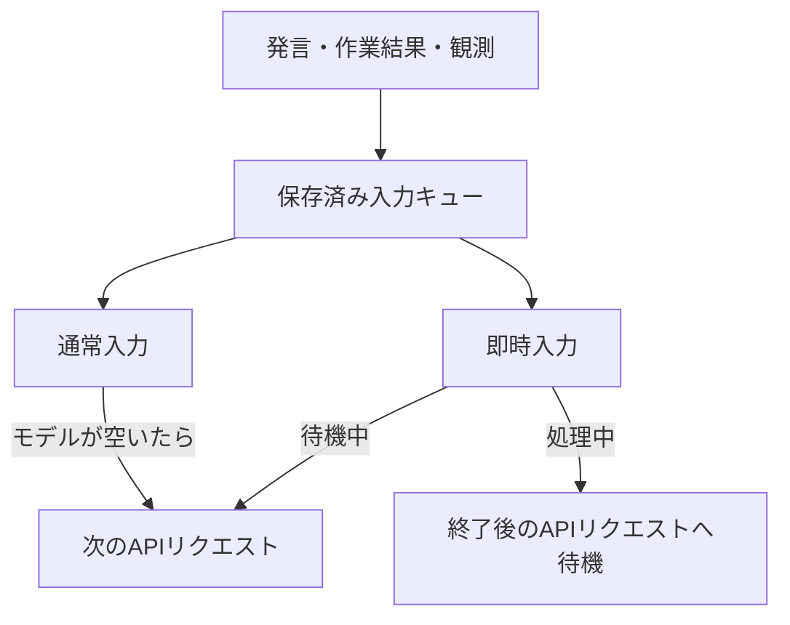

# 会話方式と差し替え境界

現在の実装は `packages/` にあります。Engineが会議ごとの状態をSQLiteに保存し、OpenAI Responses APIで会話を処理して、作業をClientへ委譲します。同じEngineで `text-speech` と `live` を選択できます。どちらでも、Discordの話者別STTと機械的な発言記録を残します。

| 責務             | text-speech             | live                             |
| ---------------- | ----------------------- | -------------------------------- |
| 音声の直接応答   | APIモデルが回答文を作成 | Liveが音声会話を担当             |
| 作業・調査の管理 | EngineのAPIモデル       | 同じAPIモデル                    |
| 実作業           | 許可されたClient        | 同左                             |
| 人間の発言記録   | ユーザー別STT           | Liveとは別にユーザー別STT        |
| 出力             | 文字とTTS               | 文字、Liveへの情報提供、Live音声 |

## 起動と認証

Engineを起動し、管理画面でOpenAI APIキーを設定します。EngineにはCodexのインストール・ログイン・専用homeは不要です。

```sh
ido-engine start --conversation-mode text-speech
```

`start` の既定値は `text-speech` です。`--conversation-mode live` は新しい会議セッションの既定方式を指定します。会議に保存済みの方式がある場合はそちらを再開します。Discordでは `/ido mode value:live` と `/ido mode value:text-speech` で会議の方式を切り替えます。閲覧者は変更できません。

`start --main-model <model>` はAPIモデルを変更します。既定は `gpt-4.1-mini` です。会話処理、STT、TTS、LiveはEngine管理画面の同じOpenAI APIキーを使います。APIキーの変更は次のリクエストから反映されます。

会話APIは各リクエストに保存済みの発言・回答履歴を上限付きで渡し、`store: false` と構造化JSON出力を指定します。外部ツールは渡しません。調査・リポジトリ操作はClient側の権限とCodex環境で実行します。

`--conversation-mode legacy` は移行前のpackages版Responsesによる回答・議事録生成を比較用に残す指定です。`v0` の起動ではありません。古い `PERSONAL_CONTEXT_VOICE_*` 設定や `/ido live on/off` は現在のEngine設定ではありません。

## 全体



プラグインの接続世代、設定の版、会議・プロジェクト、現在の参加者権限はEngineが検査します。モデルが返した話者名や権限値で、この境界を置き換えません。

## text-speechの内部



Discordプラグインは48kHz・2ch・PCM16を話者別に受け取ります。長い発話は最大20秒のWAVへ分割し、各分割を記録します。メインモデルには、分割を組み立てた発話を送ります。収録セッション、発話、分割のIDと時刻を維持し、未完了部分だけから新しい作業を開始しません。

Engineの発話コントローラーは候補の重複、取消、会議・方式の版、STT待ちを管理します。人間の音声が終わってもSTTが完了するまでは開始を待ちます。プラグインは人間が話している間の待機と再生中の即時停止を担当し、候補ID・音声セッションID・speech epochで古い音声を拒否します。TTSのOgg Opus出力RPCは、再生終了か中断まで待ちます。停止RPCはその待機を追い越して処理できます。

## liveの内部



Live用には20ms単位のPCMフレームを送り、アダプター内部で24kHz・monoに変換してミックスします。独立したSTT経路は同時に動き続けます。Liveが声からDiscordの利用者や権限を決めることはありません。

直接の音声質問へLiveが応答する場合、バックエンドの同じ直接回答を重ねて読み上げません。調査結果や新しい情報はバックエンドからLiveへ案内用の文脈として渡します。Liveは言い換えることがあり、TTSと同じ「指定文章をそのまま読む」契約ではありません。

委任通知は元のSTT発言と照合した後、既存入力への注意通知として扱います。別の作業依頼を二重に作る権限にはなりません。Liveの実際の出力トランスクリプトは、バックエンドが渡した案内文と区別して保存します。

## 通常入力・即時入力・復旧



通常入力は会議ごとの12秒タイマーで処理を促し、既にモデルが動いていれば終了後に送ります。作業Clientが動いていることは、メインモデルを待機させる理由にはなりません。明示的な呼びかけや `priority: "immediate"` は即時入力になり、`priority: "normal"` で集約を指定できます。埋め込み時は `EngineOptions.conversation.observationIntervalMs` を差し替えられます。対象が一意な停止・追加指示は主モデルの返答を待たずに処理します。

HTTPの会話APIには処理途中の入力追加を行いません。`steer` は確実な未受理を返し、即時入力を失わず次のリクエストに回します。Clientの実作業への追加指示・停止は従来の制御経路で処理します。入力キュー、会議参照、保存済み応答、処理済みバッチIDはSQLiteへ保存します。保存済み応答はAPIを再実行せず適用できます。認証エラーなど明確な拒否は未送信状態に戻し、キー修正後に再試行できます。通信切断など結果が不明な送信は保留し、自動再送しません。

旧Codexの会議参照は次のAPI実行時に置換します。旧方式で保留された入力や再認証が必要な入力は、既存の復旧操作で明示的に再開してください。更新だけでは保留入力を再送しません。

復旧操作は認証されたWorkspace契約にあります。専用の管理画面やDiscord復旧コマンドはまだありません。

| 操作                              | 用途                                                                                              |
| --------------------------------- | ------------------------------------------------------------------------------------------------- |
| `conversation/state`              | `busy`、`uncertain`、`pending`、`batchId`、再確認が必要な `awaitingSources`                       |
| `conversation/log`                | 会議の直近100件のBot出力レコード                                                                  |
| 同 `kind: "coordinator"`          | 管理者向けのタスク抽出ログ。プロジェクト単位で新しい順に20件、`nextBefore` を次の `before` に指定 |
| `conversation/control` の `flush` | 通常入力の処理を促す                                                                              |
| 同 `resolve`                      | 現在の `batchId` と `retry: true/false` による、不明なモデル入力の再送・不再送判断                |
| 同 `resume`                       | 現在の `batchId` と `sourceIds` による、復元した発言の入力コンテキスト再確認                      |

操作要求の `{ok: true}` は受付であり、モデル処理完了ではありません。再送判断にはプロバイダー履歴などの確認が必要です。復元した発言を再確認できるのは、同じ認証済みの発言者・同じプラグインからのコンテキストです。保存済みの作業提案は再確認を待ち、再起動だけで権限を復活させたり、黙って提案を失ったことにしたりしません。

文字配送も、送信結果が不明なレコードを自動で再送しません。モデル入力の調停と、外部へ届いたか不明な文字配送は別の状態です。

## 記録と差し替え

人間の発言はSQLiteのmessageレコードに保存します。議題索引は同じ会話APIリクエストで更新し、要点・決定事項・未決事項と根拠の発言IDを保存します。編集可能なMarkdown本文は既存の`MinutesDocument`とリビジョン検査付きの手動保存で管理し、議題索引から本文へは書き込みません。本文の自動生成は会話APIとは別の呼び出しです。元の発言は上書きしません。訂正は同じ議題へ反映し、延期した未決事項を解決済みにしないよう指示しています。参照先が別の会議・Botの発言・不完全な発話・存在しないIDなら、その更新を適用しません。現在のpackages版は旧JSONLアーカイブへ追記しません。Raw PCM・WAVを永続保存しません。

ActivityとClientの議事録は、進行中の会議も表示します。「元の発言を見る」から根拠の話者・時刻・本文へ移動でき、議題と発言を検索できます。Discordの議事録カードは更新した議題から文字数内に収め、全文はActivity・Clientで確認します。議事録の生成はコマンド操作を必要としません。

新規の会議Codexタスクには `meeting_context_search` と `meeting_context_read` を接続し、タスク掲示板のツールと同じターン単位のハンドラーで処理します。新規スレッドで有効にしたツール集合は再起動・再実行でも維持し、導入前のスレッドへツールを後付けしません。ローカルタスク・Claude実行は対象外です。Engineの `project.knowledge` はプロジェクト所属を確認し、`task.knowledge` はさらに割当先Client・runId・実行版を照合します。引用された発言を新しい権限として扱いません。検索結果の`documents`は手動編集を含む現在のMarkdown本文（最大3会議、各4,000文字）と保存リビジョンです。本文の続きは`meetingId`と`documentOffset`で取得します。議題索引は本文の編集とは別に更新されるため、食い違いがある場合は両方と原発言を確認します。検索は日本語を含む文字列のAND検索で、最大50発言、発言本文合計24,000文字と12議題を返します。省略は `truncated`、続きを取得できる発言ページは `nextOffset` で示します。元の保存データは省略しません。

## 会議からのタスク受付

主モデルの入力は、今回の `events` と参考用の `context`・`minutes`・`activeTasks` を区別し、`currentMessageSourceIds` に今回使える発言IDを明示します。タスクの根拠は今回の `message.source.id` のみで、イベントIDや過去の発言IDは使えません。過去・不明・空・重複のIDを含む案があれば、Engineは除外理由と元の案を `taskValidation` でモデルに返し、一度だけ訂正を求めます。モデルには今回の依頼との意味上の対応を確認させ、EngineでIDを機械的に付け替えません。訂正後も現在の権限、発話の完結、保留、プロジェクト、重複、自動受付上限を検証します。

訂正できない案が残れば、今回の依頼への返信で未登録を伝えます。有効な元の案は保持し、一部だけ登録できた場合も残りが未登録と案内します。訂正応答の `reply`・`controls`・`minutes` は適用せず、元の応答に対する検査を維持します。訂正応答は保存して再利用し、訂正の送信結果が不明な場合や送信中の再起動では自動で再送しません。

明示依頼の重複は正規化したタイトルの一致で検査し、文字の類似度だけで「明日の天気」と「今日の天気」を同一視しません。一つの発言に別々の成果の依頼があれば複数のタスクを作れます。自動提案には従来の類似度による抑制も残します。言い換えられた同じ目的の判断は主モデルが担い、Engineのタイトル照合だけで意味の一致を保証するものではありません。

抽出ログはSQLiteの `records` テーブルに `kind='coordinator-trace'` として保持します。モデル呼び出し・追加入力の `run` / `steer` と、採否の `application` を `batchId` で結びます。入力、解析済み応答（タスクなしも含む）、元の提案と根拠ID、訂正の成否、各案の採否理由と登録タスクID、開始・終了時刻を記録します。APIの生エラー・資格情報・音声は保存せず、エラーは既存の許可済み診断項目だけにします。不正JSONは解析済み応答として保持できないため、失敗状態と診断情報が残ります。

通常のエラーログの件数上限や処理済みバッチ一覧の更新では消えず、再起動後も保持します。入力・応答には私的な会話が含まれるため、ログ取得は管理者のみです。`conversation/log` に `meetingId` と `kind: "coordinator"` を渡すと同じプロジェクトのログをページ単位で取得できます。通常のBot出力ログの返却形式は変わりません。自動の期限・件数削除はなく、保存量は利用に応じて増加します。プロジェクトの完全削除では所属ログを削除し、タスクの完全削除では過去の自由文から削除対象を復元させないよう同じプロジェクトの抽出ログ全体を削除します。通常の完了・停止では消しません。

「井戸Bot、モックを作ってくれるかな」のような依頼を受け付けます。呼びかけがなくても、具体的な疑問を解く調査や会議内で判断するための小さな試作を提案できます。自動受付は1回につき1件、同じプロジェクトで同時に2件まで、前回から45秒以上を空けます。進行中の同じ目的や直近の終了タスクは重複を抑え、保留・引用・雑談からは開始しません。明示的な依頼は自動受付の待ち時間に縛られません。

受付後は、実際に保存したタスク名と受付状態を文字・音声で返します。「そのモックを青にして」「そのモックを止めて」は対象が一つなら直接適用し、完了済みタスクへの追加依頼も同じタスクの続きにします。複数の対象がある場合は特定を促します。複数人の発言を根拠に使い、操作する人の現在の権限を確認します。停止受付と、実行先が停止したことは区別します。

新規の会議タスクは実行先のモデル一覧を確認します。短い調査は利用可能ならSpark、それ以外はSolを優先し、通常の試作はmedium、設計・移行などはhighを選びます。明示選択と既存タスクのモデルは維持します。対応モデルがない場合は失敗を返し、Astraへ自動で費用を拡大しません。主モデルのAPI利用料はこのCodexモデル選択とは別です。

Bot出力は別の `conversation-output` レコードです。文字配送の `deliveryStatus` は `unknown` / `delivered` を区別します。メイン回答は `playbackStatus: "not_confirmed"`、Live断片は `"unknown"` として、生成・文字配送と実際に聞こえた範囲を混同しません。Live断片は会話文脈に加えますが、人間の指示や作業権限には変換しません。Engine終了時は処理中STTの終了と記録を待ってからデータベースを閉じます。

| 境界             | 現在の場所                                      | 差し替えるもの                                     |
| ---------------- | ----------------------------------------------- | -------------------------------------------------- |
| 主モデル         | `engine/src/ports/coordinator.ts`               | `createCoordinator` と `run/steer/interrupt/close` |
| 作業             | `engine/src/ports/work.ts`                      | 受付、操作、状態、結果                             |
| 会話方式         | `engine/src/processing/conversation-mode.mjs`   | 回答の担当と配送方針                               |
| 音声セッション   | `engine/src/output/audio/session.ts`            | Live/TTS接続と会議の音声状態                       |
| 発話制御         | `engine/src/output/audio/controller.mjs`        | 候補、検証、待機、取消                             |
| 音声プロバイダー | `engine/src/ports/models.ts` とOpenAIアダプター | STT/TTS、Liveファクトリー                          |
| 実機I/O          | `common/src/contracts/plugins.ts`               | PCM、活動、再生、文字配送                          |

表のパスは `packages/` 配下です。高水準の組み込みは `EngineOptions.conversation`、さらに細かい実装の変更はこれらのポートとコンストラクターを境界にします。SDKオブジェクトや資格情報をキューの保存データへ入れません。

## 現在の制約と検証

Discord設定の `voiceChannelId` を指定すると、プラグイン起動時にその通話へ参加します。未指定の場合は従来どおり `/join` を使います。Discord側でMessage Content Intentを許可していない音声用Botは、`messageContentIntent` を `false` にします。この設定でも通話とスラッシュコマンドは利用できますが、通常のテキスト発言の全文受信は無効になります。これらの設定を変更するとDiscordへ再接続します。

- Liveの発話生成を完全にバックエンド指示だけへ限定するものではありません。ローカル再生抑制とモデル側の文脈には差が生じ得ます。
- 委任通知とSTTの照合は時刻による推定です。発言権限は別途Engineが検査します。
- PCMは上限付きです。入力フレームのRPCが詰まるとLive用フレームを落としますが、独立STT用WAVはその制限の対象外です。Live出力にもバッファ上限があります。
- Liveアダプターは30分で接続を閉じ、失敗時と同様にSTT/TTSへ戻ります。継続接続の自動更新はありません。
- 現在のTTSアダプターは先頭500文字、Liveへの案内文は先頭350文字までです。長い回答の全文は文字出力で確認します。
- 発話候補は停止できますが、現在の `Models.speak` はHTTP用AbortSignalを受け取らず、実行済みのTTS要求まで必ず中止できるとは限りません。
- コンテクストは有限です。主モデルへの議事録投影は12,000文字に制限します。作業Codexは必要に応じて検索しますが、主モデルのAPIへ全記録を毎回渡すことはありません。議題は1会議30件までで、原発言はそれ以降も保存します。

```sh
npm run check:ido
npm run build:ido
npm run test:ido
```

対象テストは偽Liveソケット、偽プレイヤー、モックResponses API、ローカルIPCで検証します。実APIを使う評価は通常のテストやCIから分け、`IDO_LIVE_EVAL=1` を明示したときだけ実行します。`scripts/meeting-experience-eval.mjs` は日本語会話と議事録・タスク判断、`scripts/meeting-codex-eval.mjs` は実Codexの検索・同一履歴での継続・停止、`scripts/meeting-loop-eval.mjs` は合成音声から実Clientへの配布とブラウザー操作を確認します。Codex評価は既存認証ファイルへの `IDO_EVAL_AUTH_FILE` が必要です。合成音声を使う評価は実マイクや複数人の同時発話、Discordで聞こえたことの証明ではありません。比較では集約待ちとモデル・ネットワーク処理時間を分けます。移植範囲は [main2との統合](main2-conversation-integration.md)、作業制約は [WorkPort契約](work-port-contract.md) を参照してください。

## 将来の画面共有

現段階では画面を収集しません。導入する場合は、共有者が対象画面と開始・停止を選び、定期取得と「今の画面を参照」の手動取得を組み合わせる案を検討します。取得時刻・共有者・会議・直近の発言IDを結び、変化の少ない画像は重複を抑えます。保存期間・画像内の機密情報・参照権限・どの画像をタスクへ渡すかは、実装前に決める事項です。
