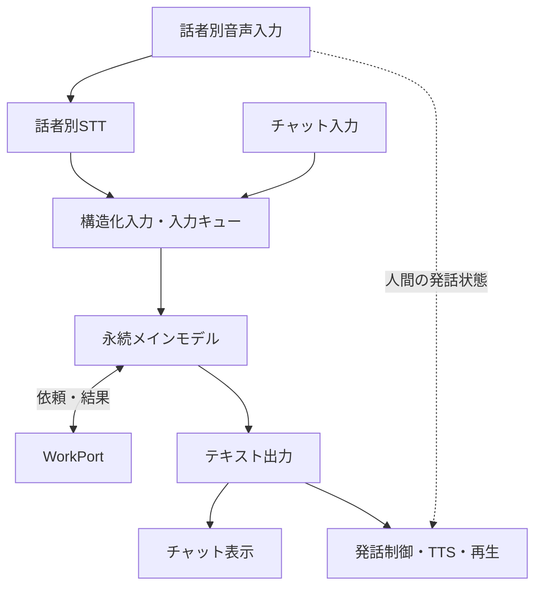
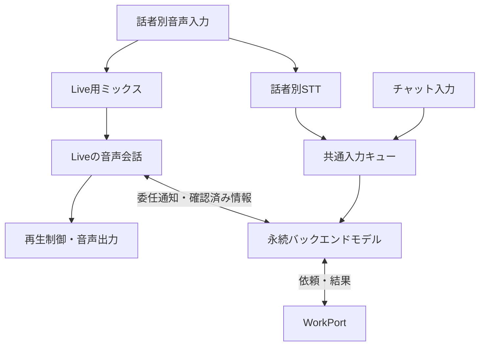
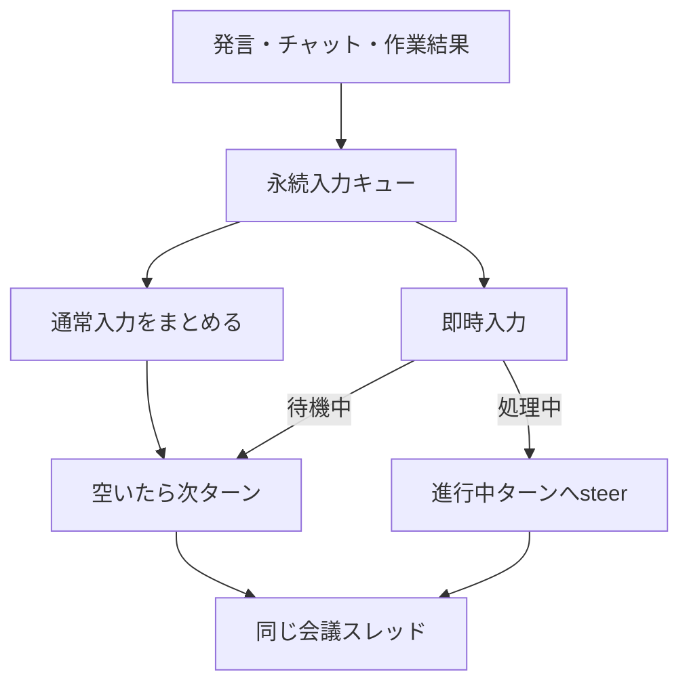

# 会話方式と差し替え境界

会議の会話処理を、永続するメインモデル、入力キュー、会話方式、発話制御、作業ポートに分けています。STT/TTS方式とLive方式は同じ実装内で選択できます。タスクの実行・担当割当・レビュー・配送は共通の作業側に残します。

この構成は `voiceMode: "meeting"` とCoordinatorポートを使用する場合に適用されます。既存の `turn` モード、およびCoordinatorを持たない互換バックエンドの観測経路も残しています。従来の一時的な観測スレッドを使う経路と、新しい永続Coordinatorを同じ会議で並行実行する構成ではありません。

## STT/TTS方式



メインモデルが会話を管理し、調査・実装をサブエージェントへ委譲し、結果から回答を作ります。音声入力一件につき必ず回答する必要はありません。通常の会話は観測として蓄積し、回答が必要な入力や作業結果を処理します。

`createSpeechController` は発話候補、同じ対象への回答の差し替え、期限、会議・会話方式の版、作業結果の実行版を管理します。TTS生成と再生は別のコールバックです。再生直前には未確定の書き起こしと会話の更新を確認し、設定された再検証器を呼びます。人間の発話開始・終了を扱う待機ゲートと実際のプレーヤー停止は音声アダプターが担当します。

メインモデルへ再生の成否を毎回送り返す必要はありません。作成した回答、配送したテキスト、再生された音声は別の状態です。候補を取り下げても、既に保存された回答文が「利用者に聞こえた」という記録にはなりません。

## Live方式



Liveが音声会話を担当し、バックエンドモデルはタスク管理・調査・結果の整理を担当します。STTはLiveと並列で動き、ミックス前のDiscordユーザーごとの音声から発言を記録します。声の推測からDiscordの本人性や権限を決めません。同じアカウントのマイクを複数人が使う場合の人物識別は、この分離の範囲外です。

Liveの委任通知は、既存のSTT発言へ注意を向けるイベントです。時刻から対応する確定発言を探し、対応が見つかるまでは待ちます。独立した二件目の作業依頼には変換しません。権限確認と重複排除は元発言を使ってバックエンドで行います。

通常の音声への直接応答をバックエンドからも重ねて出さないよう、Live方式には独自の回答採用方針があります。バックエンドの作業結果、チャット入力への回答、確認済みの訂正・新しい発見をLiveへ渡します。Liveへの案内は読み上げ原稿の厳密な再生ではなく、Liveが表現を決めるための情報です。

人が話し始めたときやミュート時は、Liveの再生バッファを破棄して音声を抑制します。Live側の生成自体を完全停止する契約ではありません。抑制中に生成された内容と、人が実際に聞いた内容が一致するとは限りません。中断位置からの完全な再開や、バックエンドの指示時だけ必ず発話する動作も保証していません。

## 共通入力キューと永続スレッド



`CoordinatorInbox` は、会議ごとのCodexスレッド参照と送信状態を保存します。メインモデルが作業していないときの通常入力は、観測間隔などによるflushまで集約できます。処理中に到着した通常入力は、現在のターンが終わってから次に送ります。サブエージェントの作業終了を待ってメインモデルを止める構成ではありません。

即時入力は、待機中なら新しいターンを開始し、処理中なら `steer` で追加入力します。キャンセルの `interrupt` とは別です。先に溜まっていた入力から順番に送るため、訂正だけがその参照先を追い越しません。実行中ターンが終了済みの場合やsteer未対応の場合は、明示的な不受理を受けて次ターンへ回します。

既定の識別器は、明示的な質問・呼びかけを即時入力とし、アダプターが指定した `priority: "normal"` を優先して集約できます。入力の優先度と応答要否は別フィールドです。`dependencies.classifyInput` を差し替えることで、識別の方法を変更できます。

入力は既定で一バッチ20イベント、イベントをJSON化した合計16,000文字までに分けます。単独で上限を超えるイベントは黙って切らずに拒否します。作成側で必要な抜粋と参照に変換する必要があります。この上限はモデルへ渡す補助文脈を含めた総トークン上限ではありません。

会議中は同じスレッドを使い、新しいイベントを差分として追加します。永続スレッドでもコンテクストは有限です。アプリ独自の無制限な履歴注入や自動全文検索は行いません。履歴圧縮後に必要な根拠が見えない場合は、ログなどの読み取り調査を作業側へ依頼する方針です。

## 保存状態と復旧

| 所有者                   | 保存・管理する状態                                                                  |
| ------------------------ | ----------------------------------------------------------------------------------- |
| MeetingSession           | 会議ID、話者別発言、表示用ログ、回答候補、依頼元、処理済みバッチ                    |
| CoordinatorInbox         | 未送信イベント、送信中バッチ、steer中入力、保存済み応答、入力受領記録、スレッド参照 |
| Coordinatorプロバイダー  | SDK接続、進行中ターン、スレッドの開始・再開・停止                                   |
| WorkPortの実装           | タスク受付、仕様・実行版、担当、追加指示、結果、配送・復旧                          |
| 発話制御・音声アダプター | 発話候補、再検証、キャンセル、人間の発話状態、音声バッファ                          |

モデルへ送る前に、入力バッチと送信状態を保存します。受領が不明な送信・steerや、送信中状態からのプロセス再起動は `uncertain` として保留します。同じ依頼を再接続だけで無条件に送り直しません。

モデルの応答本文まで保存済みなら、配送や作業受付の処理をその本文から再試行できます。モデル呼び出しをやり直す必要はありません。イベントIDと作業の `requestKey` は、復旧時にも維持します。

不明状態の解決は `session.resolveCoordinatorInput({ retry: true | false })` という内部APIです。プロバイダー履歴の確認などで再送の可否を判断した後に呼びます。`true` は再送、`false` はその入力を再送しない判断です。判断を自動化する履歴照合や、専用のDiscordコマンド・ブラウザーUIはこの変更に含まれません。

会議切り替えは処理中や入力結果不明の状態では拒否します。切り替え時は以前のCoordinatorを閉じ、会議IDと保存参照を切り替えます。DiscordのLive接続も新しい会議用に作り直し、旧会議から遅れて届いた発言記録や委任通知は受け付けません。終了時は入力・音声処理を停止し、プロバイダーの処理終了と保存を待ちます。音声会話方式の切り替えは会議そのものを作り直さず、同じ入力キューと作業状態を維持します。

## 議事録とBot発言の記録

新しいCoordinator構成の議事録表示は、話者名付きの確定発言を機械的に追加します。モデルに累積要約を毎回作らせません。表示用の本文は直近10,000文字に制限され、全文の代わりになるものではありません。日付別JSONLの会話アーカイブは独立して追記します。

音声入力のユーザーID、発言ID、会議ID、分割発話の情報を維持します。モデルの出力は `role: "assistant"` とプロバイダー情報を付けて記録します。

| 記録                       | 意味                                                                  |
| -------------------------- | --------------------------------------------------------------------- |
| 人間のSTT結果              | Discordユーザーに帰属する認識テキスト。認識精度そのものの保証ではない |
| メインモデルの回答         | 配送処理で記録された回答文。音声再生は `not_confirmed`                |
| Liveの出力トランスクリプト | 生成された文章の断片。`final: false`、再生は `unknown`                |

Liveの断片はバックエンドの会話文脈にも追加しますが、新しいユーザー依頼や作業権限には使いません。トランスクリプト断片の到着は発話完了通知ではありません。再生の完了や、利用者が聞いた範囲を推定して記録しません。

## 差し替え方法

`createConversationEngine` の依存性注入を境界にします。

| 注入箇所                                | 差し替え対象                                                                           |
| --------------------------------------- | -------------------------------------------------------------------------------------- |
| `coordinator.createCoordinator`         | 会議中のメインモデル。返却するruntimeは `run` / `steer` / `interrupt` / `close` を実装 |
| `workPort`                              | タスクキュー以降の作業基盤。指定時はエンジン内部のTaskQueueを作らない                  |
| `audio.transcribe` / `audio.synthesize` | STT / TTSプロバイダー                                                                  |
| `dependencies.classifyInput`            | 即時・集約入力の識別器                                                                 |
| `dependencies.createSpeechOutput`       | 発話候補・再検証・再生キューの管理                                                     |
| `dependencies.conversationModes`        | 会話方式の選択・回答採用・配送方針                                                     |
| `output` / `transcriptArchive`          | 表示・音声のアダプターと会話ログ保存                                                   |

外部WorkPortからの結果は `engine.acceptWorkResult`、状態は `engine.acceptWorkState` で戻します。プロバイダーや外部作業基盤の接続・終了は、それを作成したランタイムが所有します。

現在のDiscordコマンドには、従来のTaskQueueを直接利用する管理操作も残っています。WorkPort注入だけで、それらが任意の外部作業基盤にすべて対応するという意味ではありません。別の配布・クライアント基盤はエンジンを直接組み込み、その側の操作アダプターを接続します。

PR #27のエンジン／クライアント構成との項目対応、読み取り調査の権限、旧Workerとの互換条件は [WorkPort契約](work-port-contract.md) を参照してください。今回の会話実装は `packages/` を変更していません。

## 起動と方式の切り替え

Discordランタイムで両方式を試すには、既存の接続設定に加えて次を指定します。認証情報は従来のローカル設定で管理します。

```dotenv
PERSONAL_CONTEXT_VOICE_MODE=meeting
PERSONAL_CONTEXT_VOICE_POWER_MODE=true
PERSONAL_CONTEXT_VOICE_CODEX_TRANSPORT=app-server
PERSONAL_CONTEXT_VOICE_LIVE_ENABLED=false
```

`PERSONAL_CONTEXT_VOICE_MODE` の既定値は `turn`、PowerモードとLive起動の既定値は `false` です。`app-server` はCodex接続方式の既定値です。`sdk` も使用できますが、進行中ターンへのsteerを提供しない実装では即時入力を次ターンへ回します。

`/ido live on` でLive方式、`/ido live off` でSTT/TTS方式へ切り替えます。Liveは会議モードかつ音声接続がReadyの場合に開始できます。起動時からLiveを選ぶ場合は `PERSONAL_CONTEXT_VOICE_LIVE_ENABLED=true` にします。切り替え処理は直列化され、旧方式の再生停止後に新方式を選択します。

Liveが開始できない場合や実行中に失敗した場合はSTT/TTS方式に戻ります。現アダプターには30分のセッション上限があり、その到達もフォールバックになります。Live SDKはLive起動時に読み込むため、Liveリソースがない環境でもSTT/TTS方式や偽プロバイダーのテストを読み込めます。Liveを実際に起動するには対応するSDKとAPI利用環境が必要です。

通常入力の観測間隔は `PERSONAL_CONTEXT_VOICE_OBSERVATION_INTERVAL_MS` で指定し、Discordの既定値は60,000ミリ秒です。ブラウザーの現ランタイムは30,000ミリ秒です。永続メインモデルには既存の `PERSONAL_CONTEXT_VOICE_OBSERVER_MODEL` と `PERSONAL_CONTEXT_VOICE_OBSERVER_REASONING_EFFORT` を使用します。STT/TTSは既存の `PERSONAL_CONTEXT_VOICE_STT_MODEL` / `PERSONAL_CONTEXT_VOICE_TTS_MODEL` を使用します。

## 検証と残る制約

プロバイダーを置き換えたテストでは、認証や実際の音声サービスを呼び出さずに、会話方式の切り替え、発話候補の取り下げ、永続スレッドの再開、steer、調査の権限、作業との境界を検証できます。

```sh
node --test test/conversation-mode.test.mjs test/speech-controller.test.mjs test/discord-voice-live.test.mjs
node --test test/coordinator-inbox.test.mjs test/meeting-coordinator-provider.test.mjs test/work-port.test.mjs test/engine-ports.test.mjs
node --test test/architecture-boundaries.test.mjs
node --test test/coordinated-conversation.test.mjs
npm run check
npm run lint
```

実サービスの確認は別です。設定されたテスト環境で、既存の `npm run smoke:discord:voice:conversation` と `npm run smoke:discord:voice:live` を用途と送信先を確認して実行します。偽プロバイダーの成功を、Liveの実接続、実マイク、話者ごとの認識精度、音声の重なり、応答時間の確認済みとは扱いません。

この変更の検証では偽プロバイダーとローカルのアダプターテストを実行しています。実アカウントを用いたLive接続と音声往復は未検証です。

特にLiveの委任とSTT発言の照合は時刻に基づく推定です。Liveと永続バックエンドは別のモデル文脈を持ちます。Liveの自律発話、音声抑制後の文脈差、実際に聞こえた範囲の記録、長時間運転時の体感遅延は、実音声で評価する必要があります。比較時は意図的な集約待ちと処理遅延を分けて測定します。
