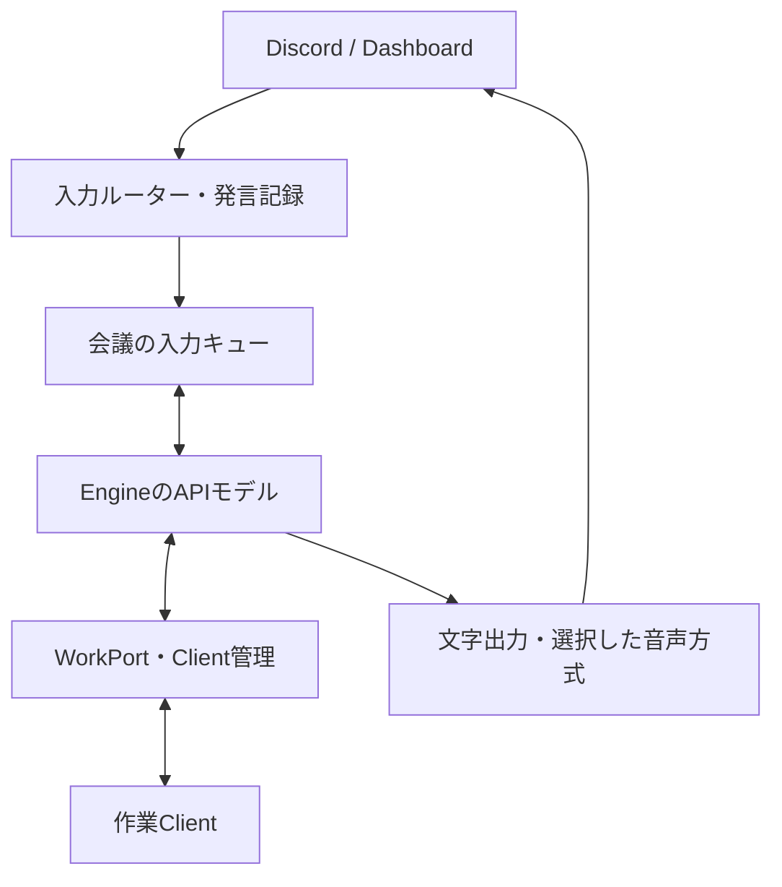
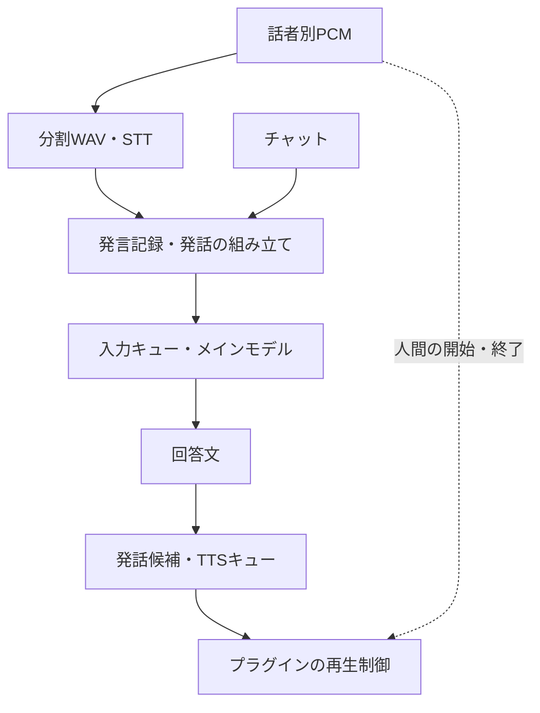
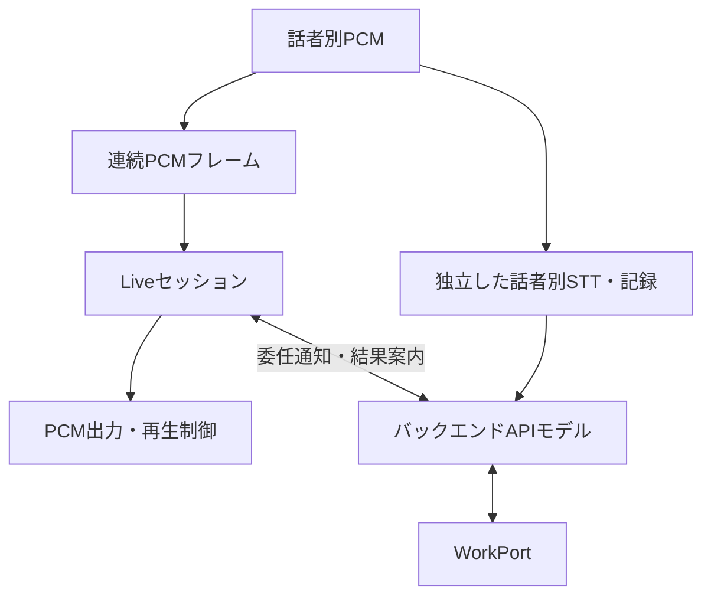
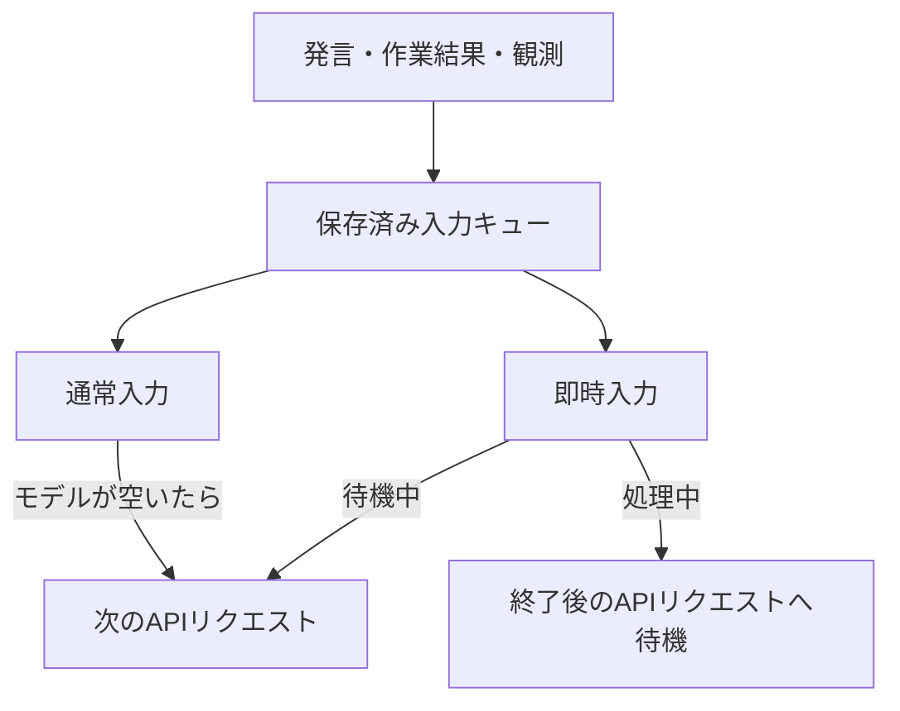

# 会話方式と差し替え境界

現在の実装は `packages/` にあります。Engineが会議ごとの状態をSQLiteに保存し、OpenAI Responses APIで会話を処理して、作業をClientへ委譲します。同じEngineで `text-speech` と `live` を選択できます。どちらでも、Discordの話者別STTと機械的な発言記録を残します。

| 責務             | text-speech             | live                             |
| ---------------- | ----------------------- | -------------------------------- |
| 音声の直接応答   | APIモデルが回答文を作成 | Liveが音声会話を担当             |
| 作業・調査の管理 | EngineのAPIモデル       | 同じAPIモデル                    |
| 実作業           | 許可されたClient        | 同左                             |
| 人間の発言記録   | ユーザー別STT           | Liveとは別にユーザー別STT        |
| 出力             | 文字とTTS               | 文字、Liveへの情報提供、Live音声 |

## 起動と認証

Engineを起動し、管理画面でOpenAI APIキーを設定します。EngineにはCodexのインストール・ログイン・専用homeは不要です。

```sh
ido-engine start --conversation-mode text-speech
```

`start` の既定値は `text-speech` です。`--conversation-mode live` は新しい会議セッションの既定方式を指定します。会議に保存済みの方式がある場合はそちらを再開します。Discordでは `/ido mode value:live` と `/ido mode value:text-speech` で会議の方式を切り替えます。閲覧者は変更できません。

`start --main-model <model>` はAPIモデルを変更します。既定は `gpt-4.1-mini` です。会話処理、STT、TTS、LiveはEngine管理画面の同じOpenAI APIキーを使います。APIキーの変更は次のリクエストから反映されます。

会話APIは各リクエストに保存済みの発言・回答履歴を上限付きで渡し、`store: false` と構造化JSON出力を指定します。外部ツールは渡しません。調査・リポジトリ操作はClient側の権限とCodex環境で実行します。

`--conversation-mode legacy` は移行前のpackages版Responsesによる回答・議事録生成を比較用に残す指定です。`v0` の起動ではありません。古い `PERSONAL_CONTEXT_VOICE_*` 設定や `/ido live on/off` は現在のEngine設定ではありません。

## 全体



プラグインの接続世代、設定の版、会議・プロジェクト、現在の参加者権限はEngineが検査します。モデルが返した話者名や権限値で、この境界を置き換えません。

## text-speechの内部



Discordプラグインは48kHz・2ch・PCM16を話者別に受け取ります。長い発話は最大20秒のWAVへ分割し、各分割を記録します。メインモデルには、分割を組み立てた発話を送ります。収録セッション、発話、分割のIDと時刻を維持し、未完了部分だけから新しい作業を開始しません。

Engineの発話コントローラーは候補の重複、取消、会議・方式の版、STT待ちを管理します。人間の音声が終わってもSTTが完了するまでは開始を待ちます。プラグインは人間が話している間の待機と再生中の即時停止を担当し、候補ID・音声セッションID・speech epochで古い音声を拒否します。TTSのOgg Opus出力RPCは、再生終了か中断まで待ちます。停止RPCはその待機を追い越して処理できます。

## liveの内部



Live用には20ms単位のPCMフレームを送り、アダプター内部で24kHz・monoに変換してミックスします。独立したSTT経路は同時に動き続けます。Liveが声からDiscordの利用者や権限を決めることはありません。

直接の音声質問へLiveが応答する場合、バックエンドの同じ直接回答を重ねて読み上げません。調査結果や新しい情報はバックエンドからLiveへ案内用の文脈として渡します。Liveは言い換えることがあり、TTSと同じ「指定文章をそのまま読む」契約ではありません。

委任通知は元のSTT発言と照合した後、既存入力への注意通知として扱います。別の作業依頼を二重に作る権限にはなりません。Liveの実際の出力トランスクリプトは、バックエンドが渡した案内文と区別して保存します。

## 通常入力・即時入力・復旧



通常入力は会議ごとの30秒タイマーで処理を促し、既にモデルが動いていれば終了後に送ります。作業Clientが動いていることは、メインモデルを待機させる理由にはなりません。明示的な呼びかけや `priority: "immediate"` は即時入力になり、`priority: "normal"` で集約を指定できます。埋め込み時は `EngineOptions.conversation.observationIntervalMs` を差し替えられます。

HTTPの会話APIには処理途中の入力追加を行いません。`steer` は確実な未受理を返し、即時入力を失わず次のリクエストに回します。Clientの実作業への追加指示・停止は従来の制御経路で処理します。入力キュー、会議参照、保存済み応答、処理済みバッチIDはSQLiteへ保存します。保存済み応答はAPIを再実行せず適用できます。認証エラーなど明確な拒否は未送信状態に戻し、キー修正後に再試行できます。通信切断など結果が不明な送信は保留し、自動再送しません。

旧Codexの会議参照は次のAPI実行時に置換します。旧方式で保留された入力や再認証が必要な入力は、既存の復旧操作で明示的に再開してください。更新だけでは保留入力を再送しません。

復旧操作は認証されたWorkspace契約にあります。専用の管理画面やDiscord復旧コマンドはまだありません。

| 操作                              | 用途                                                                               |
| --------------------------------- | ---------------------------------------------------------------------------------- |
| `conversation/state`              | `busy`、`uncertain`、`pending`、`batchId`、再確認が必要な `awaitingSources`        |
| `conversation/log`                | 会議の直近100件のBot出力レコード                                                   |
| `conversation/control` の `flush` | 通常入力の処理を促す                                                               |
| 同 `resolve`                      | 現在の `batchId` と `retry: true/false` による、不明なモデル入力の再送・不再送判断 |
| 同 `resume`                       | 現在の `batchId` と `sourceIds` による、復元した発言の入力コンテキスト再確認       |

操作要求の `{ok: true}` は受付であり、モデル処理完了ではありません。再送判断にはプロバイダー履歴などの確認が必要です。復元した発言を再確認できるのは、同じ認証済みの発言者・同じプラグインからのコンテキストです。保存済みの作業提案は再確認を待ち、再起動だけで権限を復活させたり、黙って提案を失ったことにしたりしません。

文字配送も、送信結果が不明なレコードを自動で再送しません。モデル入力の調停と、外部へ届いたか不明な文字配送は別の状態です。

## 記録と差し替え

人間の発言はSQLiteのmessageレコードに保存します。機械的な議事録表示は直近12,000文字の投影であり、全発言レコードの代わりではありません。現在のpackages版は旧JSONLアーカイブへ追記しません。Raw PCM・WAVを永続保存しません。

Bot出力は別の `conversation-output` レコードです。文字配送の `deliveryStatus` は `unknown` / `delivered` を区別します。メイン回答は `playbackStatus: "not_confirmed"`、Live断片は `"unknown"` として、生成・文字配送と実際に聞こえた範囲を混同しません。Live断片は会話文脈に加えますが、人間の指示や作業権限には変換しません。Engine終了時は処理中STTの終了と記録を待ってからデータベースを閉じます。

| 境界             | 現在の場所                                      | 差し替えるもの                                     |
| ---------------- | ----------------------------------------------- | -------------------------------------------------- |
| 主モデル         | `engine/src/ports/coordinator.ts`               | `createCoordinator` と `run/steer/interrupt/close` |
| 作業             | `engine/src/ports/work.ts`                      | 受付、操作、状態、結果                             |
| 会話方式         | `engine/src/processing/conversation-mode.mjs`   | 回答の担当と配送方針                               |
| 音声セッション   | `engine/src/output/audio/session.ts`            | Live/TTS接続と会議の音声状態                       |
| 発話制御         | `engine/src/output/audio/controller.mjs`        | 候補、検証、待機、取消                             |
| 音声プロバイダー | `engine/src/ports/models.ts` とOpenAIアダプター | STT/TTS、Liveファクトリー                          |
| 実機I/O          | `common/src/contracts/plugins.ts`               | PCM、活動、再生、文字配送                          |

表のパスは `packages/` 配下です。高水準の組み込みは `EngineOptions.conversation`、さらに細かい実装の変更はこれらのポートとコンストラクターを境界にします。SDKオブジェクトや資格情報をキューの保存データへ入れません。

## 現在の制約と検証

- Liveの発話生成を完全にバックエンド指示だけへ限定するものではありません。ローカル再生抑制とモデル側の文脈には差が生じ得ます。
- 委任通知とSTTの照合は時刻による推定です。発言権限は別途Engineが検査します。
- PCMは上限付きです。入力フレームのRPCが詰まるとLive用フレームを落としますが、独立STT用WAVはその制限の対象外です。Live出力にもバッファ上限があります。
- Liveアダプターは30分で接続を閉じ、失敗時と同様にSTT/TTSへ戻ります。継続接続の自動更新はありません。
- 現在のTTSアダプターは先頭500文字、Liveへの案内文は先頭350文字までです。長い回答の全文は文字出力で確認します。
- 発話候補は停止できますが、現在の `Models.speak` はHTTP用AbortSignalを受け取らず、実行済みのTTS要求まで必ず中止できるとは限りません。
- コンテクストは有限です。初期・復旧用の議事録投影は12,000文字に制限します。Engine内の全発言記録を主モデルや任意のClientへ検索・取得させるポートはなく、APIへ渡す履歴は上限付きです。

```sh
npm run check:ido
npm run build:ido
npm run test:ido
```

対象テストは偽Liveソケット、偽プレイヤー、モックResponses API、ローカルIPCで検証します。実際のLive接続、マイク入力、話者別認識精度、会話の重なり、応答時間は未検証です。比較では意図的な集約待ちとモデル・ネットワーク処理時間を分けます。移植範囲は [main2との統合](main2-conversation-integration.md)、作業制約は [WorkPort契約](work-port-contract.md) を参照してください。
