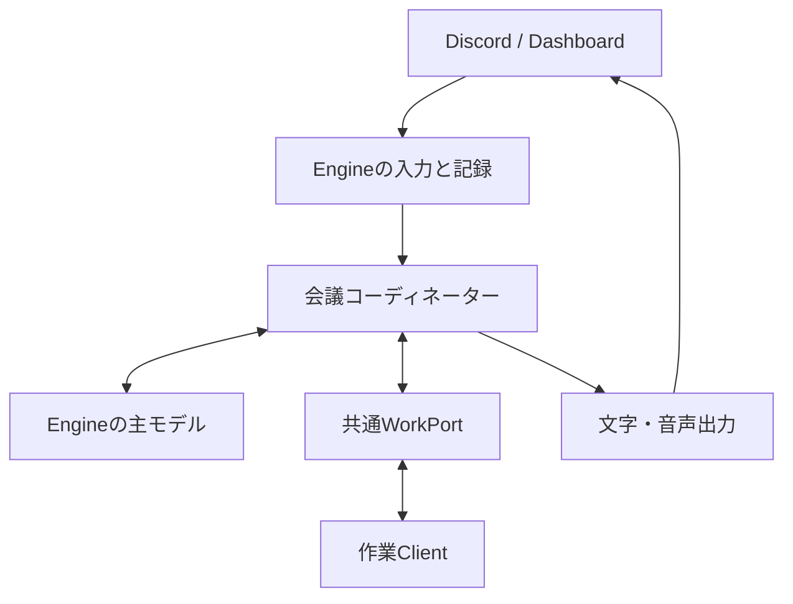
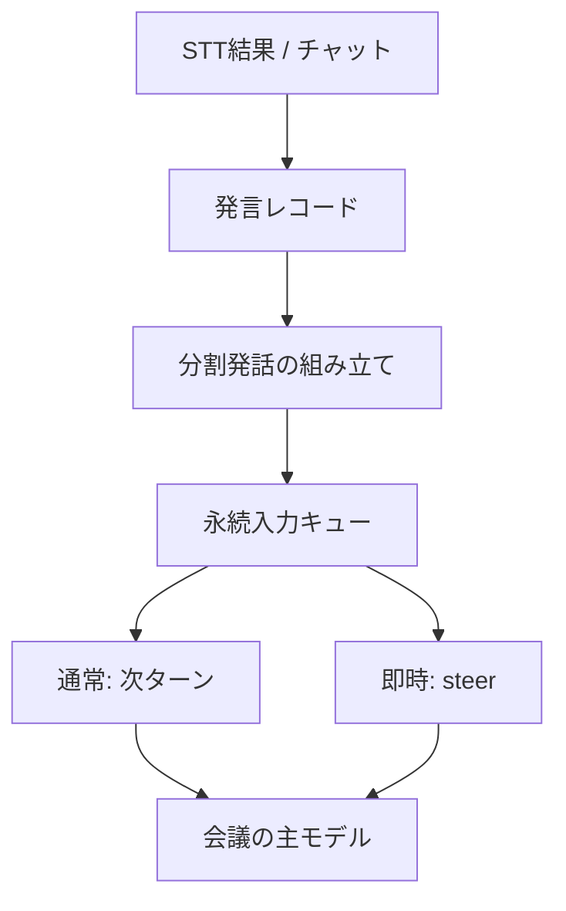
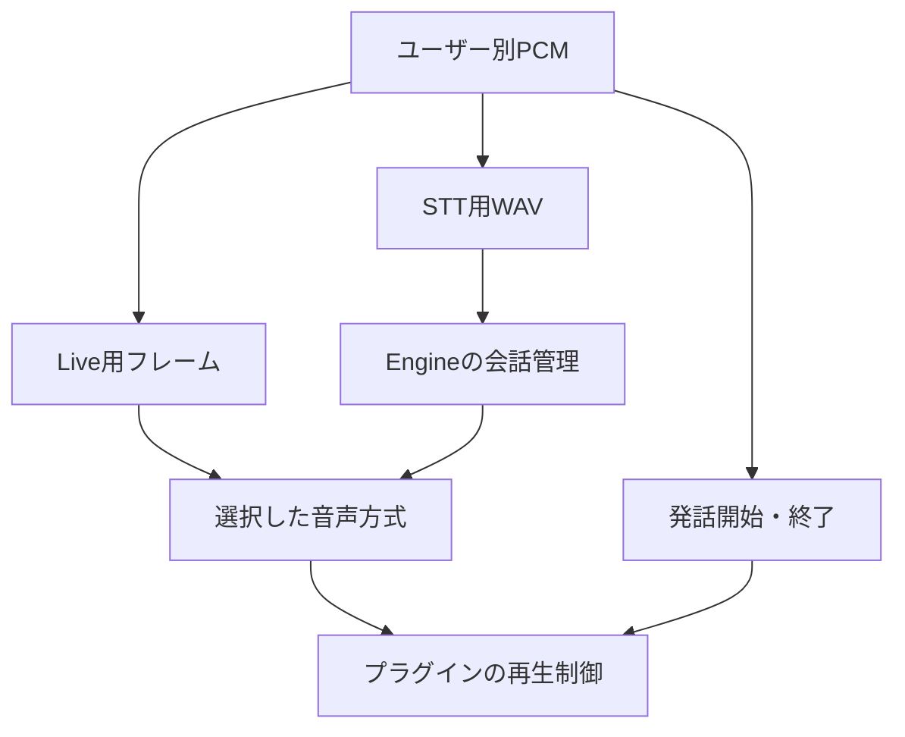
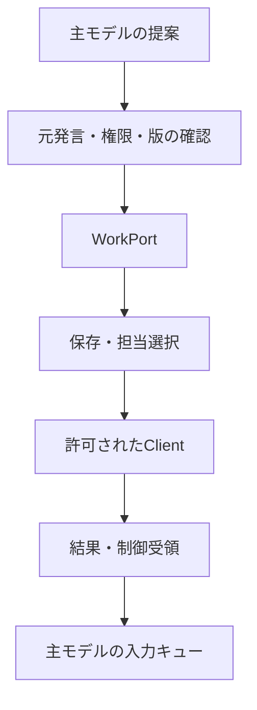

# main2への会話機能の統合

この統合作業は、会話方式の実装 `5dd00ac` とmain2の構造変更 `9cab103` を比較基準にしています。実行される正本はmain2の `packages/` 構成です。旧アプリをそのまま起動経路に戻すのではなく、会話・入力キュー・音声制御の契約を現在のEngineへ移植しています。

`v0/` はmain2側のアーカイブを維持します。現在のコードからのimport、旧ランタイムの二重起動、旧データの自動コピーはありません。この文書はソース統合の説明であり、mainへのマージや配備の完了記録ではありません。

試験用ブランチは `codex/main2-conversation-integration` です。会話実装のブランチから分岐し、main2をmergeしています。READMEの競合と、ディレクトリ移動により `v0/` に割り当てられた13ファイルの競合は、main2のアーカイブを採用して解消しました。会話実装は現在の `packages/` へ移植し、元の会話ブランチとmain2は比較用に維持します。

## 配置の決定

Engineに会議中の永続メインCodexを置き、会話・タスク・回答を管理します。Engine自身のCodex homeと認証を使用します。作業ClientはEngineの指示を受け、自分の認証・プロジェクト設定・実行許可に従って調査や実装を行います。main2の当初方針にあった「CodexはClientでのみ動く」という制約は、この統合では変更しています。

主モデルの実行と作業Clientの実行は別のライフサイクルです。Clientが作業中でも主モデルは次の会話を受け付けます。主モデルのプロバイダーオブジェクトはアダプターに閉じ、会議・作業・音声の保存データへ混ぜません。

## 再利用・置換・追加

表の旧パスは `5dd00ac`、現パスはこの統合の `packages/` 配下を指します。

| 旧実装                                                    | 現在の場所                                                        | 扱い                                            |
| --------------------------------------------------------- | ----------------------------------------------------------------- | ----------------------------------------------- |
| `src/engine/input/coordinator-inbox.mjs`                  | `engine/src/processing/coordinator/inbox.mjs`                     | 保存、通常キュー、steer、不明状態の契約を移植   |
| `src/engine/conversation-mode.mjs`                        | `engine/src/processing/conversation-mode.mjs`                     | 方式の選択と回答配送の境界を再利用              |
| `src/engine/output/speech-controller.mjs` とspeech ticket | `engine/src/output/audio/{controller,ticket,deliver,support}.mjs` | キュー、候補取消、開始条件を移植し旧依存を除去  |
| `src/providers/live.mjs`                                  | `engine/src/adapters/openai/live.mjs`                             | Live接続、PCMミックス、委任照合、出力断片を移植 |
| `MeetingSession` の会話管理                               | `engine/src/processing/coordinator/session.ts`、routing、messages | 現Repository・権限・Message構造へ組み直し       |
| `CodexVoiceRunner.observeMeeting`                         | `engine/src/adapters/codex/coordinator.ts`                        | 会議ごとの永続主モデルと独立Engine認証へ置換    |
| 旧TaskQueue・WorkerGateway                                | `engine/src/processing/tasks`、`clients`、Client WS               | main2の作業状態・配布・再接続機構を採用         |
| 旧Discordランタイムの受信・再生                           | `plugin-discord/src/{input,output,runtime}`                       | プロトコル2のプラグイン境界へ適応               |
| 日付別JSONLの会話アーカイブ                               | Engineのmessage / conversation-outputレコード                     | SQLite記録へ置換。旧JSONLへ追記しない           |
| 旧音声HUD・Electron UI                                    | main2のAdmin / Dashboard / Client UI                              | 現行UIを維持。旧UI全体の移植はしない            |

新しく追加した主な接続は、CoordinatorFactoryとWorkPort、`ConversationAudio`、話者別フレーム/活動/分割WAVのIPC、再生候補の停止と世代確認、作業ポリシーと制御受領のClient通知です。

## 入力モジュールの内部

短いPCMフレームをモデルの文字入力キューへ入れません。音声フレーム・活動は音声管理へ、STTの確定テキストは発言記録へ分けます。20秒のWAV分割は転送・認識の境界であり、別々の依頼という意味ではありません。各分割を記録し、メインモデルには組み立てた発話を渡します。

通常入力は主モデルの作業終了を待ち、即時入力は未送信の先行文脈を添えてsteerします。モデルから得た応答も保存してから適用するため、配送・タスク受付を再試行するだけならモデルを呼び直しません。不明な入力送信や外部への文字配送は、黙って再送しません。

## 音声モジュールの内部

STT/TTS方式では主モデルが回答文を作り、Live方式ではLiveが直接の音声会話を担当します。両案とも同じ会議ログと作業基盤を利用します。発話制御のEngine側は候補とSTT待ち、プラグイン側は人間の活動と実機再生を管理します。再生結果を毎回主モデルへ戻す経路は作りません。

PCM入力は48kHz・stereo、Live入出力は24kHz・mono、既存TTSの受渡しはOgg Opusです。変換は音声アダプター内にあります。PluginOutputの候補ID、音声セッション、speech epochで遅延した出力を拒否します。詳細は [会話方式](conversation-modes.md) を参照してください。

## 作業モジュールの内部

調査も独立タスクとして送ります。読み取り専用の制約はClientと交渉し、対応しないClientへ配布しません。モデルが返したタスク名、役割、利用者情報から権限を作りません。仕様の版、実行の版、制御受領を区別し、訂正前の結果を最新として回答しません。[WorkPort契約](work-port-contract.md) にフィールドと復旧の意味をまとめています。

## 実装範囲と確認

旧アプリ全体の機能同等性を意味する統合ではありません。旧自動ピアレビュー、Forumタスクスレッド、旧HUD/Electron、全種類の検証証跡・外部連携は対象に含めていません。main2のClientによる成果物・プレビュー機構は維持しています。

Engine内の保存ログを主モデルや任意のClientが全文検索するポートはありません。主モデルの永続コンテクストは有限で、初期・復旧用の投影も12,000文字に制限します。現在の読み上げ上限はTTSが500文字、Liveへの案内が350文字です。Liveは30分でSTT/TTSへ戻り、連続セッションの自動更新は行いません。

主モデル入力の `conversation/state` / `conversation/control`、Bot出力の `conversation/log` はWorkspace契約から確認できます。復旧専用画面はまだありません。再起動後の作業提案は、同じ発言者・プラグインから入力コンテキストを再確認するまで待機します。

検証は `npm run check:ido`、`npm run build:ido`、`npm run test:ido` と対象単体テストで行います。偽Codex・Live・プレイヤー、ローカルIPC、SQLiteを使った検証と、実アカウント・実音声の検証を分けます。この統合作業で実Live接続やDiscord通話は検証していません。接続更新、抑制した音声とLive文脈の差、話者認識精度、会話中の体感遅延は実環境で確認する必要があります。

今回のローカル検証では、Node.js 24で型検査、ビルド、174件のテスト、Lint、全体の整形検査が成功しました。比較元main2もビルド後に69件すべて成功しています。4パッケージのtarball作成と、Engine・Clientの新規インストール検証を実施しました。依存関係監査は検出0件です。ブラウザ試験はPlaywright用Chromiumが未導入のため実行できていません。実アカウントのCodex、STT、TTS、Live、Discord通話の成功を意味する結果ではありません。

ビルドやtarball作成だけでは、既存のEngine・Client・インストール済みDiscordプラグインは置き換わりません。配備時はそれぞれの更新と再起動が必要です。Engine・各Clientの独立したCodex認証と、音声APIキーも個別に確認します。
