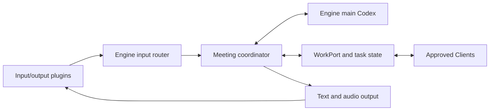

# Package architecture

Engine owns business state, the persistent main Codex model, and task supervision. Clients run delegated repository work in their own Codex environments. Plugins own input/output integrations and communicate over versioned IPC; they do not import Engine implementation. Dashboard is a standard bundled plugin, not the administration server. Engine and Client Codex authentication and homes are independent.

| Package            | Responsibilities and entry                                                                                                                                                             |
| ------------------ | -------------------------------------------------------------------------------------------------------------------------------------------------------------------------------------- |
| `engine`           | Composition in `bootstrap`; domain/ports, input, messages, processing, clients, output and management; SQLite/OpenAI/HTTP/WS/plugin adapters; React/Mantine administration at `/admin` |
| `client`           | Bootstrap, Engine connection/pairing, execution, approvals, Codex App Server, artifacts, preview and storage; its own React/Mantine UI at local port 4320                              |
| `plugin-dashboard` | Child runtime, business API, React/Mantine pages at `/dashboard/`                                                                                                                      |
| `plugin-discord`   | Child runtime, Discord normalization/policy, commands, delivery/publications, OAuth and Activity at `/plugins/discord/activity`                                                        |
| `common-ui`        | Shared presentation components and meeting/project/task/artifact views; data and actions are injected, no authentication or HTTP                                                       |
| `common`           | `contracts` for Client/Plugin messages and `runtime` for low-level utilities; no provider manifests or policy                                                                          |

Concrete adapters depend on use cases and domain/ports. `bootstrap/engine.ts` wires instances without a DI framework. SQLite persists records and transactions; task state transitions and allocation are implemented by `processing/tasks` and `clients`. `processing/coordinator/session.ts` owns a durable inbox and model handle per meeting. `ports/coordinator.ts` separates model execution from conversation decisions; `ports/work.ts` separates those decisions from Client work. `index` exports the runtime; `main.tsx` only mounts a UI.

## Plugin contract

`common/src/contracts/plugins.ts` defines protocol **2**, manifests, normalized conversation input, replies and business events. `common/src/runtime/rpc.ts` implements request/reply IDs, errors and bounded deadlines. Client protocol remains version 1. A protocol/manifest identity mismatch rejects launch and terminates the child.

Plugin lifecycle operations are `inspect`, `validate`, `start`, `configure`, `event` and `output`; stopping terminates the child and closes pending RPC calls. A plugin's `start` may return a loopback HTTP port. Its manifest declares a unique base path and explicit public paths. `/` is an exact public path; a non-root trailing slash denotes a prefix. Private requests require an Engine session and mutation CSRF checks before proxying. The proxy strips browser cookies and untrusted identity headers and injects an opaque context credential. Business operations resolve that context against current Engine membership and permissions again. Provider-supplied roles are never adopted.

Plugin-to-Engine operations include `input`, workspace `state`, `projects`, `meetings`, `messages`, `tasks`, `task/control`, `artifact`, `preview`, `identity.me`, `identity.link`, `identity.session`, and namespaced `storage.get`/`storage.put`. Member contexts are plugin/generation/session scoped. Activity credentials have a restricted operation set. Plugins that accept external speakers send their provider subject; Engine resolves it to a linked member or a conversation-only participant. The latter cannot log in or register Clients. Provider policy, OAuth validation and SDK use belong to the provider plugin.

The Engine catalog supplies package identity and the launch path. To add an input/output plugin, implement the public contract and register a catalog entry in bootstrap (or supply `EngineOptions.pluginCatalog` for an embedding/test). Conversation and persistence implementations do not change. A third synthetic plugin in `engine/test/plugins.test.ts` exercises this boundary without importing Engine code. Plugin code is trusted local code running with the OS user's permissions, not a security sandbox.

Generations change on start/stop; revisions change on configuration and voice invalidation. Pending input, replies and context credentials are fenced against those values and current roles. Discord additionally fences queued playback against its speech epoch. Business events go to running plugins subscribed through their meeting binding; an unbound Dashboard observes all meetings. Dashboard polls fresh snapshots, including after restart, so notifications are not its state authority. Discord card IDs reside under `plugin:discord`, separate from meetings.

Protocol 2 has optional `audio-stream` and `playback-control` capabilities. Discord sends attributed PCM frames, activity events and bounded WAV segments with capture/session IDs. Frames are validated and routed separately from durable text/STT input. `audio-frame` and `audio-stop` outputs carry candidate IDs; encoded `audio` output waits for playback completion or interruption. The plugin owns the human-speech gate, codec conversion and player. Legacy text plugins need neither capability. Details are in [conversation modes](conversation-modes.md).

## Message processing and migration

Text and audio use the same input router. The input ID is namespaced by plugin and durably accepted before asynchronous work. WAV segments are transcribed and recorded with their speaker and capture metadata; the coordinator receives an assembled utterance rather than treating each audio segment as an independent request. Mechanical transcript projections replace repeated model-generated minutes in the coordinated modes. Normal inputs queue while the main model is busy; urgent inputs steer its active turn. Results and Live transcript observations use the same inbox. Model output supplies source references and proposals; Engine rechecks current identities, permissions, task versions and source completeness before accepting work.

`text-speech` makes the persistent coordinator responsible for answers and uses the speech controller for TTS delivery. `live` keeps the same backend/task state while Live owns direct spoken conversation; independent STT still supplies attributed records. `start --conversation-mode legacy` retains the previous packages-based Responses reply/minutes path for comparison. It does not start or import `v0`.

Messages live in separate SQLite records with transcription, reply, minutes and delivery states, including skipped, pending, running, failed and interrupted. Meeting responses include a projected message list for consumers, but the stored meeting contains no message array. Error IDs reference redacted Engine diagnostics. Raw audio is not retained.

Opening a version-0 Engine database creates `engine.before-v1.sqlite` using SQLite `VACUUM INTO` (including committed WAL contents) before a transactional version-1 migration. It separates existing messages, namespaces input/external identity IDs, moves provider publication IDs, and preserves current configuration records. Backups use owner-only permissions on POSIX. Existing migrated backups are not overwritten. Unsupported future versions fail closed. On startup, uncertain pending processing becomes interrupted and is never automatically replayed. Do not run old and new Engine versions concurrently against one data directory. To roll back, stop Engine, retain the migrated database separately, and restore the backup with SQLite WAL/SHM files removed while no process has it open.

Client journals, worktrees, credentials and dedicated Codex home retain their existing paths and recovery guarantees. The persistent coordinator stores its handle and inbox in Engine SQLite and uses a separate Engine Codex home. A saved response can be applied without another model run; unknown model input requires explicit reconciliation and is not automatically replayed. No `v0` data or Electron migration is included. See [the integration mapping](main2-conversation-integration.md).

Consumers declare `@ido/common-ui` as a development dependency and use its package exports (`@ido/common-ui` and `@ido/common-ui/style.css`). The exports resolve exclusively to `dist`; React and Mantine are peer dependencies. Application bundles include the compiled UI, so installed tarballs do not depend on the private workspace. See [common UI build instructions](../packages/common-ui/README.md) for rebuilding during development.

Consumers use the compiled `@ido/common/contracts/...` and `@ido/common/runtime/...` exports for shared code. Browser imports stay separate from Node runtime modules. Common builds before common-ui; common-ui declarations reference the compiled common contracts. Runtime packages bundle common and declare it as a development dependency; common-ui declares it as a dependency for its public types. See [common build instructions](../packages/common/README.md).

## Validation and distribution

`check:ido` first builds `@ido/common` and then `@ido/common-ui`, then checks backend and UI types. `build:ido` checks import boundaries, compiles `@ido/common` into JavaScript and declarations, builds `@ido/common-ui` into JavaScript, declarations and CSS, bundles each runtime, builds four React/Mantine entries from that compiled package, and embeds Dashboard runtime/assets in the Engine tarball. `verify:ido` performs shared compilation once for the entire check/build/test sequence. `IDO_PACKAGES` selects verification suites; CI expands that selection to include affected consumers and Engine integration tests using `.github/filters.yml`. Development-tool tests are kept separately in `scripts/test/`. `pack:ido` produces Engine, Client, Dashboard and Discord packages. Engine includes the official Codex runtime for its main model; Discord SDK dependencies remain in the optional plugin. Main model processes start lazily when a meeting requires them.

`test:ido` covers the legacy reply/minutes path, coordinator persistence and steering, duplicate input, ordered concurrency, audio framing and interruption, role/generation fences, plugin shutdown, backup migration, Client policy negotiation/control and previews. `smoke:ido` exercises browser setup, business views, Client pairing, Dashboard stop/restart and sandboxed preview operations. `smoke:ido:pack` installs fresh local tarballs and verifies their runtime/UI. These tests use synthetic users, mocked providers and local services; real Live audio, provider credentials and publication are separate checks.
