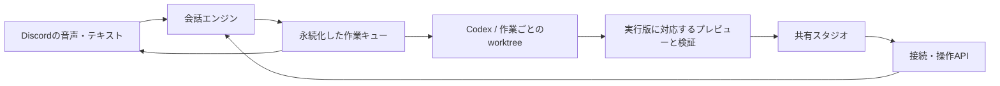

# 共有スタジオで、話す・つくる・試すをつなぐ

共有スタジオは、会話から生まれた案をCodexに作らせ、その場で全員が触って直すための画面です。中央に動く成果、右側に会話と仕様を置きます。Discordの音声から作ったタスクも、同じエンジンに接続すればブラウザから操作できます。

このガイドは、エンジンを起動する人と、当日に実装を再現するチーム向けです。初めて使うときは「ブラウザだけで試す」から「一つの成果をみんなで直す」までを読み、設計・再実装・デモの節は必要に応じて参照してください。Node.jsとGitの基本操作を前提とします。

## ブラウザだけで試す

ブラウザ版はDiscord Botや音声APIのキーを必要としません。Node.js 24、Git、ログイン済みのCodex CLIを用意します。実行中の訂正とプレビューには、既存の音声版と同じCodex App Server接続を使います。

```sh
npm ci
npm run hud:install
npm run hud:build
npx playwright install --with-deps chromium
npm run studio:demo:init -- /absolute/path/to/new-demo
IDD_STUDIO_CONFIG=/absolute/path/to/new-demo/studio.config.json npm run start:studio
```

初期化先には、新しいディレクトリを指定してください。架空の展示データを持つGitリポジトリと、ローカルの設定ファイルを作ります。既存のフォルダーは上書きしません。

起動後、表示された `/studio` のURLを開きます。接続コードは、表示されたローカルの `access.json` にあります。`operatorCode` は作業の実行・変更用、`viewerCode` は閲覧用です。コードを持つ人の接続を許可する方式で、個人アカウントの認証ではありません。表示名を入力して接続してください。

Codexの認証元が通常のホームディレクトリと異なる場合は、設定の `codexHome` にそのディレクトリを指定します。たとえばWSLからWindows側でログインしたCodexを使う場合が該当します。トークンの内容を設定ファイルに貼り付ける必要はありません。

### 接続後、最初に試すこと

1. 左側で完成済みの成果を選び、中央の画面のボタンを押します。これは画像ではなく、生成したアプリそのものです。
2. 「ここを直したい」で、たとえば「見出しを『今日の展示』に変えて。他の条件は維持して」と送ります。同じ成果の仕様版が進み、Codexの実行後にプレビューが更新されます。
3. 「新しくつくる」から別の依頼を出します。展示サンプルなら「booths.jsonの展示を、場所順に探せる案内にして。スマートフォンで使えること」と指定できます。
4. 二案を作った場合は「比較する成果」からもう一方を選びます。「発表画面」では成果を大きく見せられます。

ブラウザ専用で起動したスタジオと、Discord Botに接続したスタジオは別の会話・作業です。Discordの発言を確認するときは、Botの起動ログに出るURLを開いてください。音声では「井戸Bot、挨拶文のテキストファイルを作って」のように、呼びかけと具体的な依頼を一続きで伝えます。明確な作成依頼は、定期的な会話解析を待たずに受け付けます。会話欄の「Codexに聞く・頼む」も明示的な依頼として扱います。

作業の受付と、Codexによる完成は別の段階です。受付後は左側にタスクが現れ、完成までの状態を確認できます。ブラウザで成果を操作するには、対象プロジェクトに合ったプレビュー起動コマンドの設定が必要です。

テキストやソースコードなど、Webプレビューを持たない成果も中央で確認できます。「成果ファイル」の「内容を見る」でテキストを読み、「保存」で手元へ取り出します。プレビューがある成果のファイルは「仕様」タブから確認できます。取得するのは表示した実行版で追加・変更された通常ファイルで、次の修正中の内容に置き換わりません。1ファイル8MBまで、一覧は先頭200件です。削除されたファイル、リンク、認証情報・ログなどの除外対象、別のPCで実行した成果はこの取得経路に含みません。

### 自分のプロジェクトを使う

`examples/studio.config.json` の `projects` に、作業するGitリポジトリを指定します。プロジェクトごとに会話・作業キュー・状態保存先が分かれ、画面左上から切り替えられます。リポジトリは設定ファイルで選びます。ブラウザからホスト上の任意のディレクトリを指定するAPIはありません。

| 設定                        | 指定する内容                                                                   |
| --------------------------- | ------------------------------------------------------------------------------ |
| `projects[].id`             | 英数字・ハイフン・アンダースコアによる一意な名前                               |
| `projects[].name`           | 画面に表示する名前                                                             |
| `projects[].directory`      | 対象Gitリポジトリの絶対パス                                                    |
| `projects[].previewCommand` | プレビューの起動コマンド。引数を配列にし、ポート番号の位置へ `{port}` を入れる |
| `projects[].previewChecks`  | 自動確認するボタン・入力欄の名前と、操作後に見える文字列                       |
| `stateDirectory`            | 会話・作業・接続コードを保存するローカルのディレクトリ                         |
| `codexHome`                 | 必要な場合だけ指定する、ログイン済みCodexの認証元                              |
| `browserExecutable`         | 同梱のChromium以外を使う場合の実行ファイル                                     |

プレビューには本番相当の起動コマンドを使ってください。共有用の中継はHTTPの読み込みとフォーム送信に対応し、開発サーバーのHMR用WebSocketは中継しません。サンプルは依存関係やビルド処理を持たない静的Webアプリです。

## Discordの会話と同じ画面を開く

音声Botの設定へ、次を追加して再起動します。`hud:build` も先に実行してください。

```dotenv
PERSONAL_CONTEXT_VOICE_STUDIO_PORT=4311
PERSONAL_CONTEXT_VOICE_STUDIO_NAME=チームの共有スタジオ
```

起動ログのURLから共有スタジオを開けます。接続コードの保存先は、音声Botの `STATE_PATH` に `.studio-access.json` を付けたファイルです。Discordの会話、ブラウザの発言、タスクの追加指示は同じエンジンへ届きます。ブラウザ専用の別キューへ仕事を複製することはありません。

音声の細かな処理を確認する既存HUDは、`PERSONAL_CONTEXT_VOICE_HUD_PORT` で別に有効化できます。共有スタジオの「動き」タブでは、作業に関係する処理記録を簡潔に見られます。

### 別の端末からつなぐ

同じローカルネットワークで使う場合は、設定の `host` を `0.0.0.0`、`publicOrigin` をホストの実際のHTTPアドレスと固定ポートへ設定します。音声Botでは、それぞれ `PERSONAL_CONTEXT_VOICE_STUDIO_HOST`、`PERSONAL_CONTEXT_VOICE_STUDIO_PUBLIC_ORIGIN` に対応します。

スタジオ本体に加え、各プレビューが使うポートへ参加端末から到達できる必要があります。WSLとWindowsの間、別のPC、スマートフォンでは通信経路が異なります。接続できた端末だけを試用済みとして扱ってください。インターネットへの公開やHTTPSの配信構成は、このローカル起動手順には含めません。

## 一つの成果をみんなで直す

会話欄の「みんなに話す」は、通常の発言を共有します。Botへの呼びかけがなければ見守ります。「Codexに聞く・頼む」は明示的な呼びかけとして届きます。作るものが決まっていれば、「新しくつくる」から依頼と満たしたい条件を直接送れます。

成果が届くと中央のプレビューで実際に操作できます。「この版を試した」は、表示された仕様・実行版に対する試用報告です。「ここを直したい」から送ると、同じ作業とCodexセッションに追加指示が届きます。実行途中でも訂正を受け付けます。

別の人が仕様を更新している間に書いた指示は、そのまま最新の仕様への指示に読み替えません。古い版から送信すると、最新の内容を確認するよう表示します。通信結果が不明な場合は「同じ送信を再試行」を使います。送信IDを維持し、受付済みの仕事を重複させません。

二案を試すときは、新規作成で「二つの案を並行してつくる」を選びます。共通の依頼・条件を使い、案Aと案Bを別の作業場所で実行します。最大2件を同時に進められます。並べて見た後は、選んだ案に追加指示を送ります。コードの統合や採用決定は自動では行いません。

| 状況                                   | 次の操作                                                           |
| -------------------------------------- | ------------------------------------------------------------------ |
| 実行中の作業を止めたい                 | 対象の成果を選び「停止」                                           |
| 完了後に直したい                       | 「ここを直したい」から追加指示                                     |
| プレビューが期限切れ・再起動後になった | 最新の成果を選び「プレビューを開き直す」                           |
| エンジンとの接続が切れた               | 入力を保持したまま自動で再接続。結果が不明な送信は同じIDで再試行   |
| ブラウザを再読み込みした               | 同じタブの接続は保持。エンジンが再起動した場合は接続コードで再接続 |
| 作業結果はあるがプレビューがない       | 「仕様」で結果を確認し、起動コマンドや失敗内容をホストが確認       |

会話の下書き、新規作成の入力、選んだ成果はプロジェクトごとに同じタブへ保存します。再読み込みや再接続後も復元し、別のプロジェクトへ切り替えた文章を混ぜません。送信結果が不明な操作も保持します。「同じ送信を再試行」で受付を確認するまで、新しい依頼で上書きしません。作業の停止は、この受付確認とは別に依頼できます。

## 設計の中心は、会話と成果の対応を失わないこと

ブラウザUIは実行機構を持ちません。操作APIが本人確認と送信IDを受け持ち、会話エンジンが発言・仕様・作業キューを管理します。Codexは作業ごとに独立したGit worktreeで実装します。プレビューと自動操作の確認は、その実行結果に対応して起動します。



操作の対象は、会議ID・タスクID・仕様版・実行版で特定します。仕様版は追加指示で進み、実行版はCodexの実行で進みます。実行中に仕様が変わった場合、以前の結果を現在の仕様の完成品として扱いません。停止後や期限切れのリンクも、現在のプレビューとして表示しません。

接続コードは役割を選ぶための秘密情報です。コードからサーバーが参加者IDを発行し、ブラウザの申告だけで操作権限を付けません。APIはBearerトークン、接続元、Hostを確認します。生成したWebアプリはスタジオとは別のオリジンで配信し、スタジオの認証情報を読めないiframeへ表示します。プレビューの中継先は、管理下にあるlocalhostのサーバーに限定します。

実装の対応は次のとおりです。

| 役割                                | ファイル                                                   |
| ----------------------------------- | ---------------------------------------------------------- |
| 会話・作業の共通エンジン            | `src/engine/conversation.mjs`, `src/engine/task-queue.mjs` |
| ブラウザ操作と永続的な受付          | `src/adapters/browser/controller.mjs`                      |
| 接続・役割・HTTP API                | `src/runtime/studio-server.mjs`                            |
| 成果を別オリジンで届ける中継        | `src/runtime/preview-relay.mjs`                            |
| Discord不要の起動・複数プロジェクト | `src/runtime/browser/`                                     |
| 共有画面・発表画面                  | `ui/src/Studio.tsx`, `ui/src/studio.css`                   |

## 当日は、最初の一往復を先に完成させる

再実装の最小到達点は「二人が同じ成果を開き、一人の訂正で同じ作業の最新版へ進めること」です。音声方式の追加やVR接続は、この到達点の後に判断します。

1. 会話エンジンとCodexへの実行境界を作る。作業は独立したworktreeで実行し、依頼と結果の対応を残す。
2. 一つのプロジェクトに絞り、ブラウザから作成・追加指示・停止をつなぐ。送信IDによる重複防止と仕様版の照合もこの段階で入れる。
3. 実際に触れるプレビューを中央へ表示する。二人目の端末で操作し、訂正後も同じ作業へ戻ることを確かめる。
4. 通常の会話と明示的な依頼を分け、音声からの依頼も同じキューへ入れる。
5. 発表画面と二案比較を追加する。別プロジェクトで一度試し、特定の展示ページだけの仕組みになっていないことを示す。

この順序なら、途中でも一つの体験が成立します。Codexには、境界ごとに小さく実装・検証・修正を任せます。UIの設計、実ブラウザでの検証、エンジンの版管理は別の観点で確認し、コード生成が終わっただけで完成にはしません。

## デモは「隠す」から「下に並べる」への訂正を見せる

想定する利用者は、短い時間で来場者向けの案内を作りたい展示チームです。作る人だけでなく、案内を試す人がその場で直せることを見せます。サンプルの展示名・説明はすべて架空です。

最初に二人で「スマートフォンで使う」「ログインはいらない」と話します。次にBotへ「今体験できる展示だけを見せる案内を作って」と依頼します。完成したプレビューを二人目が操作し、「準備中を隠すのではなく、下へまとめて」と訂正します。同じタスクの仕様版と成果が更新され、条件を守ったまま挙動が変わるところまでが一つのデモです。

60〜90秒の説明では、生成を待つだけの時間を作らず、準備済みの初版から訂正を始められます。その場合は「ここまでが先ほどの実行結果」と明示します。録画や画像を使う場合も、ライブ実行と混ぜて見せないでください。

発表の冒頭は、次の一文から始められます。

> 井戸Botは、チームの会話から作ったものを、その場で全員が触って直せる開発の場です。

続けて、来場者のための案内という用途、二人目による訂正、Codexに任せた実装・検証・修正を説明します。人間は欲しい体験と採用する案を決め、Codexは作成から確認までを繰り返します。

| 審査で伝えること   | 画面・実物で見せる根拠                                                     |
| ------------------ | -------------------------------------------------------------------------- |
| Codexの活用        | 初版、検証記録、訂正後の実行版。開発に用いたskillsと検証方法も具体的に説明 |
| 実世界での用途     | 展示チームが案内を作り、現場の人が試して直す一連の操作                     |
| 再利用             | 接続設定、プロジェクト切替、別リポジトリで作った別用途のアプリ             |
| デモの明快さ       | 大きな成果、短い会話、訂正による見た目と挙動の変化                         |
| 参加者が感じる価値 | 説明のあとに本人の端末で触れること。端末での到達確認は別途必要             |

提供された当日プログラムでは、開発開始は10:15、提出期限は15:15です。14:00に新機能を止め、14:30までに通し実行と録画を用意し、15:00の提出を目標にします。これは作業配分の推奨で、イベント側の追加規定を置き換えるものではありません。

## 検証は、模擬実行と実際のCodexを分けて残す

```sh
npm run verify
npm run hud:build
npm run smoke:discord:voice:hud
npm run smoke:studio
```

`smoke:studio` は模擬の実行結果を使い、二つのブラウザ、同じタスクへの訂正、古い仕様からの操作拒否、二案比較、切断復帰、320・768・1024・1440pxの表示を確認します。これだけではCodexの実行成功を示しません。

音声Botの環境変数を設定済みなら、`npm run smoke:discord:voice:invocation` で合成音声の呼びかけ、実際の音声認識・返答、Codexによるファイル作成を確認できます。APIを利用する有料の試験です。Discordには接続せず、一時リポジトリ内で実行するため、参加者へ試験メッセージは送りません。

実際のCodexは、サンプル用のスタジオを起動したうえで明示的に試します。このコマンドはCodexを呼び出し、設定したサンプルリポジトリに作業を作ります。

```sh
IDD_STUDIO_LIVE_URL=http://127.0.0.1:4311/studio \
IDD_STUDIO_LIVE_ACCESS=/absolute/path/to/new-demo/state/access.json \
npm run smoke:studio:live
```

出力は実行時間と確認した項目、ローカルのスクリーンショットです。二つの自動ブラウザを人間二人の試用として数えません。実際の会場ネットワーク、別PC、スマートフォン、複数人の音声会話は、その環境での確認が必要です。試していない環境を成功扱いしないでください。

2026年9月13日の実行では、展示案内の初版が約294秒、同じ成果への訂正が約68秒、別リポジトリのチェックリストが約270秒でした。各1回の実測で、所要時間の保証ではありません。展示案内の二案は実際のCodexを同時に動かして作成し、並べた画面で操作しました。案Aは最初の見出しが指定と一致せず、追加指示で直した後に再確認しています。Windows側のブラウザからのプレビュー操作も確認しました。

操作に迷った場合は、画面のエラーと「仕様」「動き」をホスト担当者に見せてください。接続コード、トークン、会話の全文は、公開Issueや発表資料へ貼り付けないでください。

用語: **部屋**は同じ会話と作業を共有する単位、**仕様版**は依頼・訂正の版、**実行版**はCodexの実行結果の版、**プレビュー**はその版を実際に操作するための一時的なWebアプリです。
