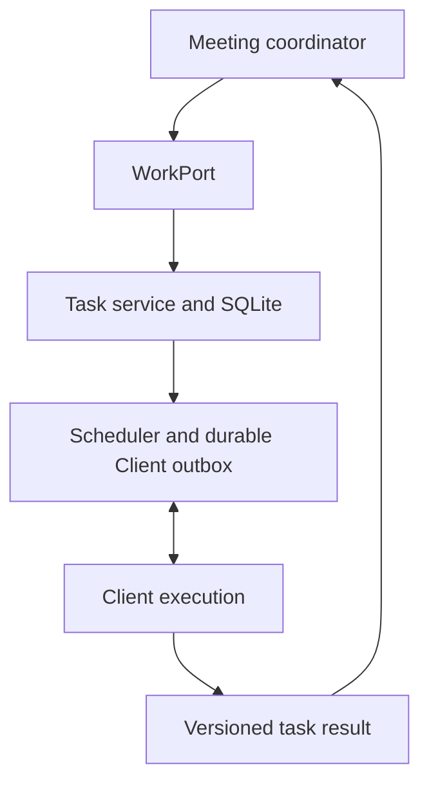

# Conversation-to-work contract

The current contract is `packages/engine/src/ports/work.ts`. Its implementation,
`processing/tasks/work.ts`, adapts the packages task service and repository. The
Engine's persistent main model proposes work; the Engine validates the source
and supervises approved Clients. Clients own repository access, execution,
approvals, worktrees, artifacts and previews. No runtime imports the `v0` archive.

## Operations

| Operation                                       | Current result            | Meaning                                                                |
| ----------------------------------------------- | ------------------------- | ---------------------------------------------------------------------- |
| `submit(request)`                               | Cloned `Task`             | Transactionally accepted or existing task; does not wait for execution |
| `control(control)`                              | Cloned `WorkReceipt`      | Durable control receipt, separate from Client delivery/settlement      |
| `list(meetingId?)`                              | Cloned tasks              | Meeting-filtered current task state                                    |
| `getReceipt({requestKey, authorId, projectId})` | Task or undefined         | Lookup by the same identity used for deduplication                     |
| `getResult(taskId)`                             | `WorkResult` or undefined | Text, source references, versions and supersession state               |

These methods are synchronous in the current SQLite-backed adapter. They are
not the old `TaskQueue` boolean-returning API. `submitResearch`, `bindExecution`,
Discord thread surfaces and the old WorkerGateway are not part of this port.



`WorkRequest` carries `requestKey`, meeting/project/author IDs, request text,
optional title and kind, requested/proactive trigger, source IDs/statements/sequences, execution policy and
network request. The adapter maps `requestKey` to `Task.requestId`. Deduplication
uses `[authorId, projectId, requestKey]` and rejects reuse across meetings.
Unknown acceptance must be reconciled with that identity rather than retried
under a new key.

Source identity and permission are established from Engine records and live
input contexts before submission. The port also rejects missing actors and
viewers. Model-supplied task text, speaker identity, project or permission claims
are not authorization. The coordinator preserves the accepted source statements
and their provenance, and may include the model's title and acceptance criteria
as task instructions. Author, project and source grants still come from Engine
records. A concrete, source-backed opportunity can become a small proactive task within the coordinator's per-project limits; a model proposal alone cannot authorize unrelated work or incomplete speech. Multiple participants may contribute evidence, while the last eligible requester owns the requested work.

## Versions and control receipts

| Field                            | Meaning                                     |
| -------------------------------- | ------------------------------------------- |
| `Task.id`                        | Stable task identity                        |
| `Task.runId` and `Task.revision` | Current execution identity and run revision |
| `specRevision`                   | Requested specification version             |
| `resultSpecRevision`             | Specification version covered by the result |
| `controlVersion`                 | Ordered task-control version                |
| `requestKey` / receipt ID        | Idempotent operation identity               |

`WorkControl` supports `stop`, `instruction` and explicit `retry`, with an
optional `expectedControlVersion`. The adapter maps `instruction` to the task
service's `steer`. A follow-up to a completed task uses `retry` with `continuation`, preserving task identity, workspace and Codex history while advancing the specification. Receipts retain `accepted: true` independently of `delivery`:
`pending`, `queued`, `applied`, `stopped`, `uncertain` or `rejected`.

A queued instruction is not proof that the active model consumed it. A stop
receipt is not a stopped process until the Client reports settlement. Commands
and returned receipts retain run, specification and control versions; stale
devices or results cannot update another run. Unknown steering delivery is not
automatically repeated. An explicit retry can carry
`instructionResolution: "retry" | "discard"` after reconciliation.

`getResult` exposes both the current specification version and the result's
covered version. A result from an older specification, or a task with uncertain
control delivery, is marked superseded. The conversation inbox receives current
completed/failed results and the main model decides the user-facing answer.
There is no worker-to-Live shortcut for announcing completion.

## Read-only investigations

Read-only research is an ordinary independent work task with explicit execution
restrictions. `kind: "research"` is a label and does not itself enforce a sandbox.
The coordinator supplies the read-only policy when delegating eligible questions:

```json
{
  "kind": "research",
  "executionPolicy": {
    "sandboxMode": "read-only"
  },
  "network": false
}
```

`common/src/contracts/work.ts` defines `ExecutionPolicy` and its normalization.
Supported sandbox values are `read-only` and `workspace-write`; the optional
`networkAccessEnabled` field further restricts network use. A request cannot
widen a Client's project mapping or network grant. Effective restrictions are
persisted and intersected on continuation/retry; read-only or network-disabled
work cannot silently become less restrictive.

Clients advertise `executionPolicyVersion: 1`. The scheduler leaves a restrictive
task queued when no compatible Client is available, and the connection/executor
also checks support. Older Clients can continue eligible unrestricted work but
are not selected as read-only research executors merely because network access
is disabled. Raw paths, credentials and local Codex handles are not supplied by
the conversation request.

The main model uses the OpenAI Responses API with the Engine API key and no
external tools. It is not the executor for these research tasks.
Client policy negotiation and local opt-in still apply even when Engine and
Client happen to run on the same machine. Engine archival logs are not exposed
as a general log-reading tool to the main model or arbitrary Clients; read-only
repository investigation does not imply access to that full history.

## Replacement and validation

`CoordinatedConversation` receives a `WorkPort` through its options. Default
bootstrap wiring uses `createWorkPort({repository, tasks, onChange})`; `onChange`
wakes the existing scheduler. A replacement supplies equivalent identities,
durable acceptance, versioned controls/results and restrictions. It must not
start another task-state store alongside the authoritative repository without
an explicit ownership design.

Current task transport remains Client protocol 1 with additive work-policy and
receipt fields. Plugin protocol 2 is a separate input/output contract. Old
WorkerGateway policy announcements and Codex thread IDs are not interchangeable
with Client connection identities.

The current integration does not provide the old automatic peer-review loop,
Forum task threads or every legacy artifact/evidence field. Existing packages
Client artifacts and previews remain its work output mechanisms.

`engine/test/work.test.ts`, Client execution/control tests and the coordinated
conversation tests cover deduplication, restrictions, version checks and recovery
with synthetic inputs and fake execution. Run `npm run verify:ido` from the
repository root. These tests do not establish live Client authentication or real
repository execution. See [the migration mapping](main2-conversation-integration.md)
for the reused and replaced components.
