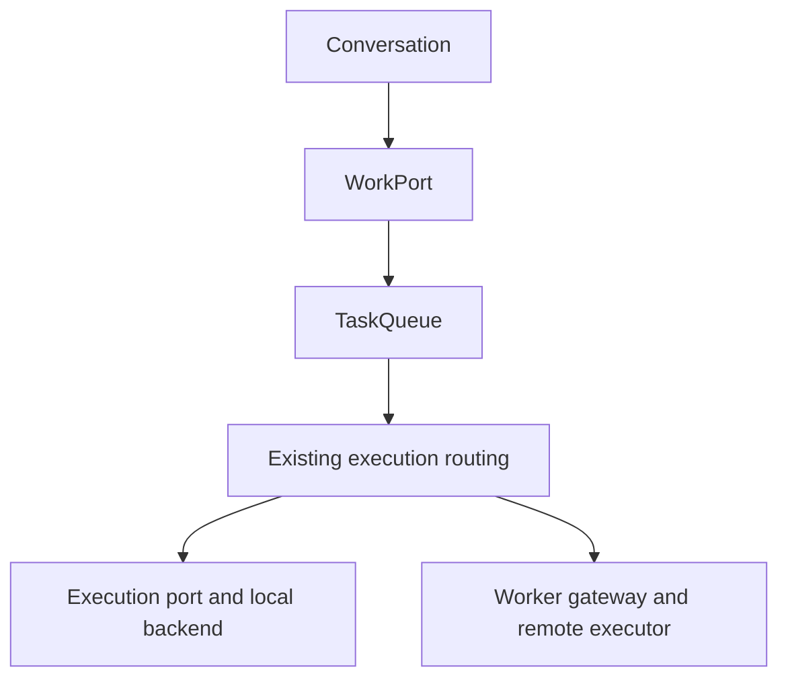

# Conversation-to-work contract

The conversation engine depends on a data-only work port. The default adapter
is `createWorkPort(queue)` in `src/engine/work-port.mjs`. A runtime can replace
the work implementation without making the conversation depend on worker
sockets, Discord surfaces, Codex thread objects, credentials or workspace paths.

Source authorization belongs to the conversation application before submission.
Durable acceptance, assignment, execution, review and delivery belong to the
work implementation. A model proposal and a worker capability announcement do
not create permission for an external operation.

## Operations and current adapter

| Work operation            | Current TaskQueue mapping                       | Semantics                                                                                                         |
| ------------------------- | ----------------------------------------------- | ----------------------------------------------------------------------------------------------------------------- |
| `submit(request)`         | `enqueueDurable(request)`                       | Resolves `true` after durable acceptance; `false` when unavailable/full. It does not wait for execution.          |
| `submitResearch(request)` | `enqueueDurable` with explicit read-only policy | Same receipt semantics; forces `kind: "research"` and `sandboxMode: "read-only"`.                                 |
| `control(control)`        | `handleVoiceControlDurable(control)`            | Preserves the queue's data receipt. Durable receipt is not proof that the worker has stopped or consumed a steer. |
| `list()`                  | `list()`                                        | Returns cloned task summaries.                                                                                    |
| `getReceipt(requestKey)`  | `getReceipt(requestKey)`                        | Resolves submission identity and current state for retry/recovery.                                                |
| `getResult(taskId)`       | `getTaskResult(taskId)`                         | Returns result text, execution/specification versions, verification and supersession state.                       |

Requests preserve `id`, `meetingId`, `requestKey`, `title`, `request`, `context`,
`sourceSequences`, `sourceStatements`, `acceptanceCriteria`, `kind`, `complexity`,
`modelSelection`, specification versions and execution restrictions. The
conversation uses `requestKey` to reconcile duplicate submission; it must not
retry an ambiguous acceptance under a newly invented key.

A control contains `type` (`stop` or a follow-up), `taskId`, `requestKey`, optional
`expectedControlVersion`, and the follow-up `instruction`. The caller authorizes
the operation before invoking this internal port. Existing queue methods for
transport-specific identity checks remain available to their adapters.

State and result events return through the runtime's existing TaskQueue
`checkpoint`/`onResult` callbacks. There is no second event bus or parallel task
state store. A replacement implementation supplies equivalent callbacks and
feeds results to the main model's input queue. Optional delivery references in
the legacy summaries, such as `threadId`, are opaque UI metadata, not model or
task identity.

## Execution boundary

The work implementation calls `bindExecution(backend)`. `runTask` and `reviewTask`
receive cloned task data. Live execution objects stay inside the backend;
checkpoint callbacks return only the permitted execution state. Reviews now
cross this same port instead of reaching directly into `CodexVoiceRunner` from
the runtime. Review support remains optional, and the current local review does
not promise remote review support.

The present mappings are:



An unsupported active steer must remain unsupported or become a queued
follow-up, rather than being reported as consumed. Remote cancellation currently
acknowledges dispatch and settles the gateway lease; it has no worker-stopped
acknowledgement. This adapter preserves that limitation and does not rename its
receipt into a termination guarantee.

## Research restrictions and worker compatibility

`executionPolicy` permits only:

```json
{
  "sandboxMode": "read-only",
  "networkAccessEnabled": false
}
```

Each field is optional; supported sandbox values are `read-only` and
`workspace-write`. The policy restricts existing executor settings. In
particular, a task cannot enable networking on a worker whose local network
setting disables it. `kind: "research"` alone is classification and does not
grant or restrict authority; the trusted application submits read-only research
through `submitResearch` or sets an explicit restrictive policy.

`authorizeMeetingResearchTasks` accepts only source statements marked by the
application as `readOnlyResearchEligible: true`, using the existing permitted
actor projection. It rejects context-only statements, already handled actions,
missing sources and unpermitted actors. A question can therefore remain
`taskEligible: false` for implementation while authorizing a read-only
investigation. Task text and author attribution are reconstructed from the
original statements; model-supplied permission fields are discarded.

The effective restrictions are checkpointed as `effectiveExecutionPolicy` and
retained when a task resumes. A follow-up or a model change cannot widen a
previous read-only/network-disabled execution. Widening requires a separately
authorized task. Local Codex and the remote worker both apply these restrictions
to their sandbox and web-search options. The worker persists them before model
execution, including runs that fail or are interrupted.

The current worker wire carries restrictions as `executionPolicy`; it does not
allow the sender to select local paths, credentials or cached thread IDs. Workers
advertise `executionPolicyVersion: 1` during authentication/pairing. The gateway
rejects restrictive tasks for older workers with `WORKER_POLICY_UNSUPPORTED`
before dispatch. Existing unrestricted tasks remain compatible. The current
router may reassign this pre-execution rejection to another eligible executor.

A future worker transport must preserve explicit restrictions, task/request
identity, specification versions, receipt meaning and the distinction between
unsupported, accepted and completed operations. These requirements belong to the
work adapter; the conversation engine does not depend on a particular wire
message format.

## Engine/client rewrite integration

The `codex/engine-client-rewrite` snapshot `78e07d2` introduces a separate
`packages/common/src/protocol.ts` and `packages/engine` store. This branch does
not modify those packages. The following is an adapter mapping for integrating
the conversation internals with that work subsystem, not a claim that it is
already connected:

| Conversation/work data                   | Rewrite protocol                            | Integration requirement                                                                                           |
| ---------------------------------------- | ------------------------------------------- | ----------------------------------------------------------------------------------------------------------------- |
| `requestKey`                             | `Task.requestId`                            | Preserve the same retry identity; do not regenerate on ambiguous acceptance.                                      |
| `meetingId`                              | `Task.meetingId`                            | Preserve meeting isolation.                                                                                       |
| Authorized source actor                  | `Task.authorId`                             | Resolve from trusted actor records; never model output.                                                           |
| Runtime project binding                  | `Task.projectId`                            | Supply from trusted meeting/project configuration.                                                                |
| `request`, source references and context | `Task.text` plus adapter metadata           | Retain structured source provenance separately; a text concatenation alone loses attribution and source versions. |
| `specRevision`, `runRevision`            | `Task.revision`, `Task.runId`               | Distinguish requested specification from actual execution. These fields are not interchangeable counters.         |
| `control(stop/instruction)`              | Store `control(stop/steer)`                 | Adapt durable receipts and version checks; retain unknown delivery state on recovery.                             |
| `getResult`                              | Stored `Task.result`                        | Also provide result version, supersession and verification metadata.                                              |
| `executionPolicy.networkAccessEnabled`   | `Task.network` and client `Mapping.network` | Effective networking is the intersection of request restriction and client grant.                                 |
| `executionPolicy.sandboxMode`            | No field in this snapshot                   | Add a negotiated restriction before routing read-only investigations to that client executor.                     |

In that snapshot the client executor uses `sandboxMode: "workspace-write"` and
`requireWritableSandbox: true` unconditionally. It must not be treated as a
read-only research executor merely because `Task.network` is false. The old
worker's `executionPolicyVersion` is specific to its existing protocol; a new
transport may negotiate capabilities differently while preserving the same
restriction contract.

The rewrite's `Conversation.process()` currently performs its own Responses
analysis, minutes generation and task creation. When connecting the new meeting
coordinator, replace that conversation entry path with the engine adapter; do
not run both task-creation paths on the same input. Worker distribution, grants,
Discord transport and the package store remain owned by the surrounding work
subsystem.
